# 3 寸 FPV 穿越机 · 设计、打印与仿真

> 一台手搓的 3 寸四轴：**机架自己画、自己 3D 打印，电子件买现成**。<br>
> 这个仓库记录为什么这么选、怎么打印、哪里会振、哪里会炸，以及仿真到底算出了什么。

**当前状态（2026-10）**：方案 / CAD / 采购 / 仿真已完成；**打印、装配、试飞还没开始**。

---

## 30 秒看懂

| 问题 | 答案 |
|---|---|
| 我在做什么？ | 135 mm 轴距的 3 寸 FPV，PLA 打印 X 机架，1106 电机 + 3S 电池 |
| 机架怎么来？ | Fusion 画 DXF → 拉伸/导出 STL → PLA 打印；不是买现成碳板 |
| 动力是什么？ | 1106 4200KV + Gemfan 3020-3 + 3S 650mAh，推重比约 **5.5** |
| 推荐什么材料？ | **PLA 4.0 mm 机臂**；5–6 层蒙皮、5 圈壁、60–80% gyroid，机臂根部 100% |
| 仿真做了什么？ | 机臂模态 / **整机装配模态** / 1P、3P 响应 / stack 孔拉脱 / 底板臂根 / 4 个长槽半孔 |
| 最重要的结论？ | **不用买碳纤维**；PLA 4.0 够用；但必须加垫片、倒圆、加筋、做桨动平衡 |


*Z 层叠：底板 → 22 mm 支撑柱 → 飞控 → 上层板 → 相机 → 电池。先看懂这张，再看下面的细节。*

---

## 先看图：这个仓库里到底有什么

### A. 机架与装配

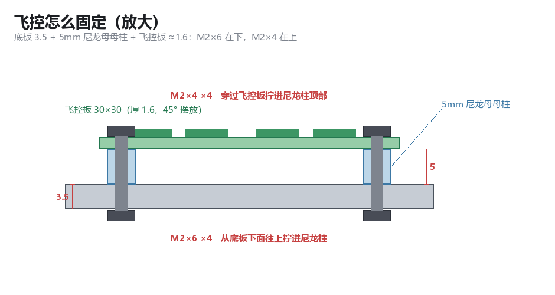

*飞控固定：底板下面 M2×6 拧进 5 mm 尼龙母母柱，上面 M2×4 压住飞控；不是直接硬压板。*

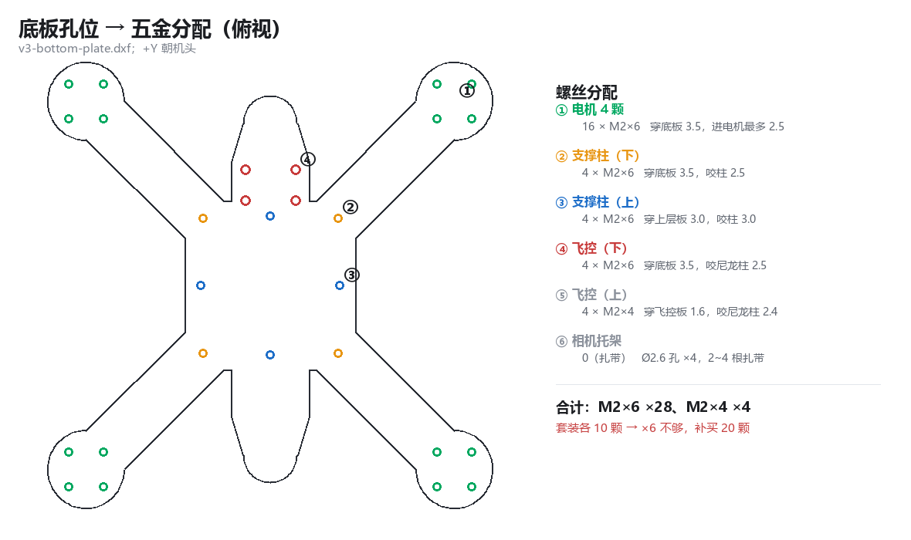

*底板孔位 → 五金分配。电机螺丝只能用 M2×6，再长会顶到线圈。*

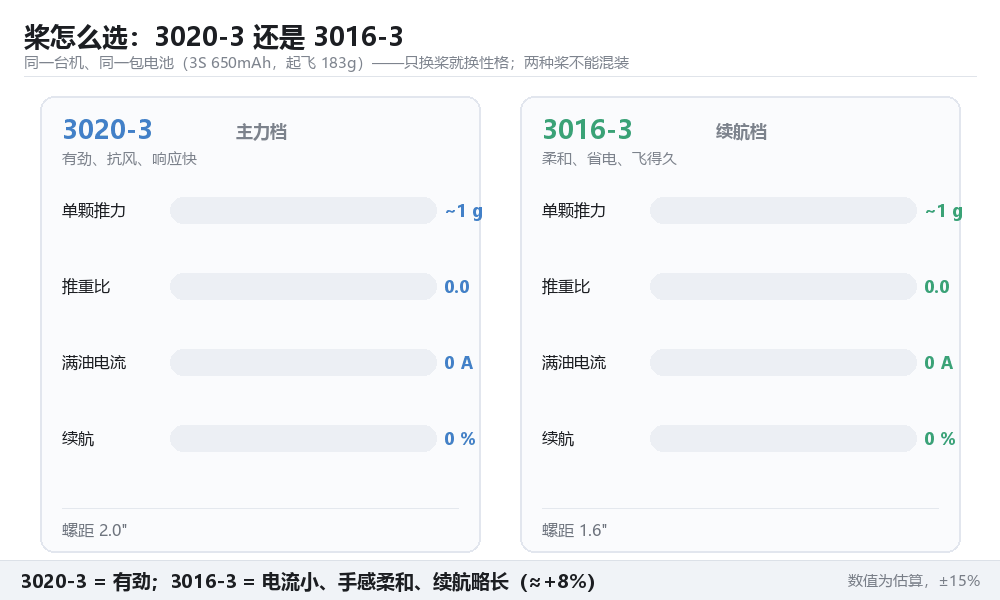

*3020-3 vs 3016-3：3020 有劲、抗风、满油约 34 A；3016 柔和、续航约 +8%。*

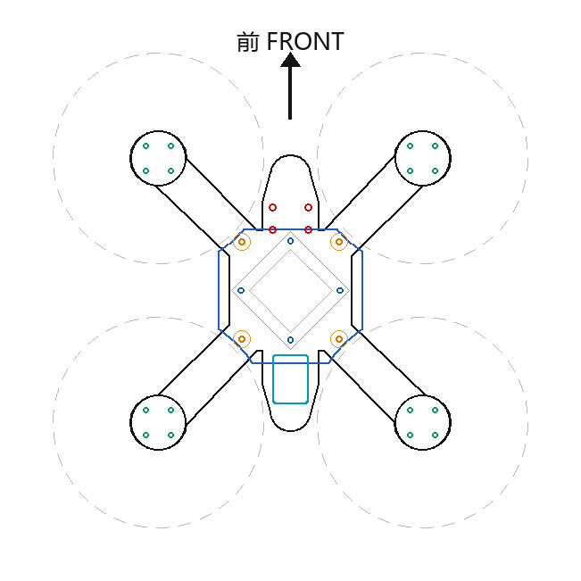

*v3 机架俯视预览；DXF 在 [`outputs/cad`](outputs/cad/)。*

### B. 振动：PLA 4.0 到底够不够

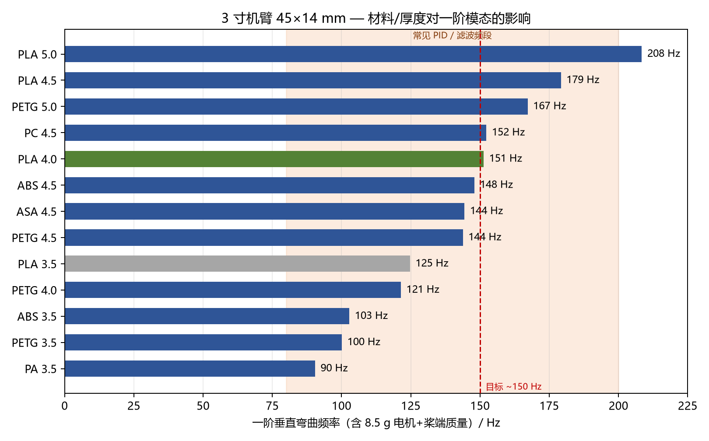

*一阶垂直弯曲频率：PLA 3.5 = 125 Hz，**PLA 4.0 = 151 Hz**，PLA 4.5 = 179 Hz；PLA 4.0 是成本和刚度的平衡点。*

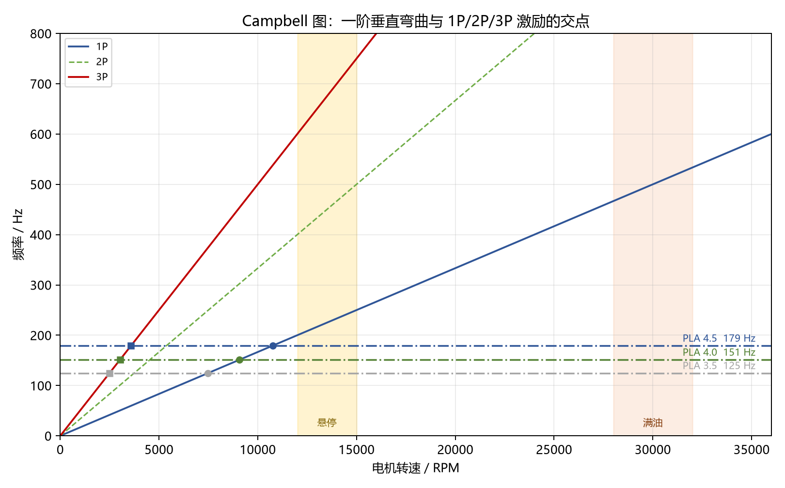

*一阶模态与 1P/2P/3P 激励的交点。PLA 4.0 的 1P 交点在约 **9.1k RPM**，3P 在约 **3.0k RPM**；悬停 12–15k 已经在交点之上。*

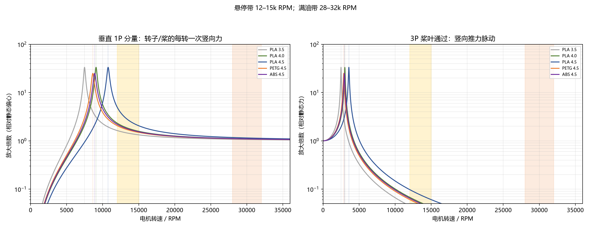

*左：每转一次竖向分量；右：3P 桨叶通过。危险区是 **2.5–10k RPM 的低油门段**，不是悬停点。*

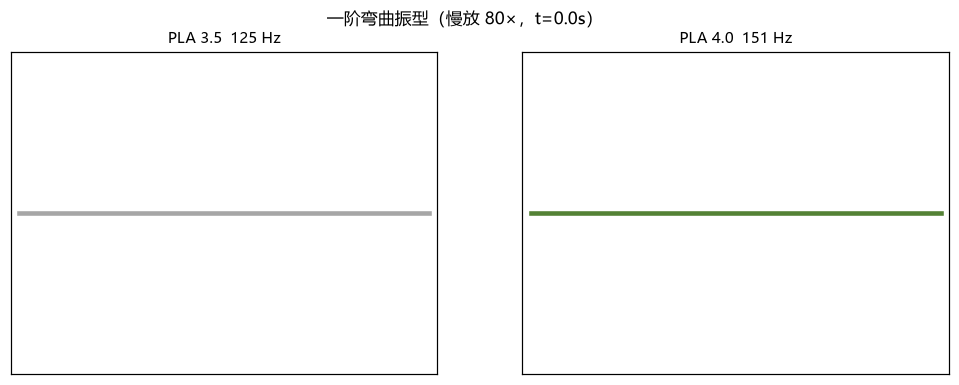

*一阶弯曲振型慢放：PLA 4.0 更硬、频率更高；注意这是归一化振型，不是实际振幅。*

### B2. 整机装配模态：为什么单根机臂不够

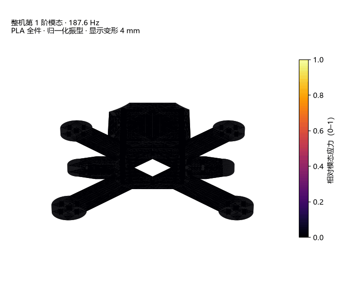

*整机第 1 阶 **187.6 Hz**，PLA 全件，显示变形 4 mm。6 个壳体粘接、4 个电机 8.5 g + 电池 60 g 集中质量；颜色是相对模态应力。*


*整机第 2 阶 **230.2 Hz**。第 1/2 阶都在悬停 1P（12–15k RPM = 200–250 Hz）附近；这是单根机臂模型没有暴露出来的整机/stack 模态。*

**网格收敛（全 PLA，最终 0.7/1.6 mm）**

| FE 网格 | 节点 | 四面体 | 第 1 阶 | 第 2 阶 |
|---|---:|---:|---:|---:|
| 1.0 / 2.2 mm | 68,809 | 301,770 | 198.66 Hz | 243.75 Hz |
| 0.8 / 1.8 mm | 79,179 | 351,180 | 186.14 Hz | 228.96 Hz |
| **0.7 / 1.6 mm** | **86,053** | **384,776** | **187.57 Hz** | **230.18 Hz** |

最后两档 f1 只差 **0.8%**，可认为收敛；粗网格把 f1 高估了约 5.9%。动画表面另外 subdivide 两次：**7,040 → 112,640 个三角形**。

**前 8 阶弹性模态**

| 阶 | 频率 | 主要方向 | 1P 交点 | 3P 交点 |
|---:|---:|---|---:|---:|
| 1 | **187.6 Hz** | Z（垂直） | 11.3k RPM | 3.75k RPM |
| 2 | **230.2 Hz** | Z（垂直） | 13.8k RPM | 4.60k RPM |
| 3 | 276.8 Hz | Z+Y | 16.6k RPM | 5.54k RPM |
| 4 | 285.4 Hz | Z+X | 17.1k RPM | 5.71k RPM |
| 5 | 340.9 Hz | Y/扭转 | 20.5k RPM | 6.82k RPM |
| 6 | 416.2 Hz | Z+Y | 25.0k RPM | 8.33k RPM |
| 7 | 557.0 Hz | Y/扭转 | 33.4k RPM | **11.14k RPM** |
| 8 | 561.0 Hz | Z（垂直） | 33.7k RPM | **11.22k RPM** |

按 ζ=0.015 的单自由度筛选：12k RPM 时第 1 阶放大倍数约 **8**；13.8k RPM 时第 2 阶可到 **25**；12k RPM 的 3P 正好落在第 7/8 阶附近，放大倍数约 **6–7**。这些是筛选值，不是实测；但“频率落在悬停带”这件事必须用实际悬停 RPM + 黑匣子 FFT 确认。

> 重要：这版是**全 PLA**，柱顶加了 1 mm 夹紧环代表螺丝/垫片。真实柱子是黄铜的话，频率会上移；必须先量实际悬停 RPM 和黑匣子 FFT，再谈“会不会共振”。

详见 [docs/10 整机装配模态](docs/10-整机装配模态.md) 和 [outputs/assembly](outputs/assembly/)。

### C. 冲击：stack 孔、底板臂根


*100 N 单螺丝向上拉脱，前侧 stack 孔 3D 特写；变形放大 300×。亮环就是 PLA 最吃力的一圈。*


*拉脱力 0 → 100 N → 0；孔边亮环逐渐出现，其他区域基本是黑的——**不是整板压坏，是孔边先到极限**。*

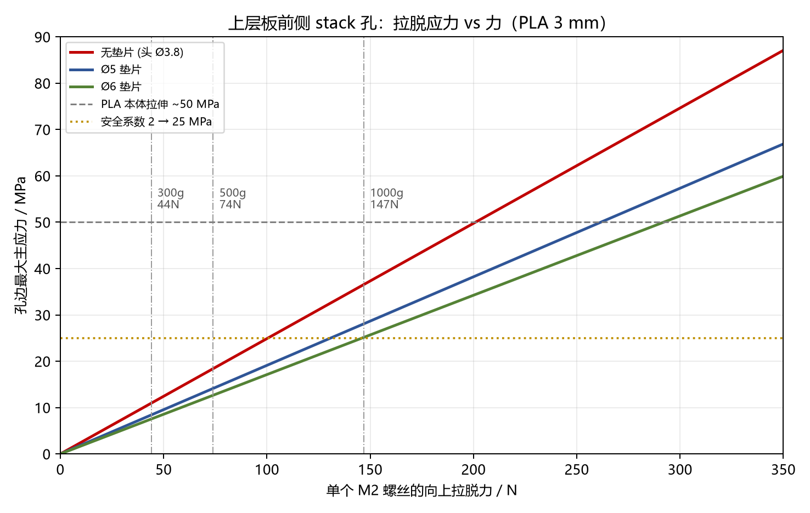

*无垫片 / Ø5 / Ø6 的孔边应力曲线。100 N 时无垫片约 24.9 MPa，Ø5 约 19.1 MPa，Ø6 约 17.1 MPa。*


*同一 100 N 下，垫片把孔边应力从 24.9 MPa 降到 17.1 MPa；**Ø5–6 钢垫片是性价比最高的加强**。*


*电池/上板 75 g 整体压在板上：1000 g 才约 24 MPa；整体弯曲不是主要矛盾，局部拉脱才是。*


*底板 FL 臂 50 N 电机向下载荷（约 600 g 等效），真实变形。臂根/菱形尖角最亮——**整台飞机最危险的冲击位置其实是这里，不是 stack 螺丝**。*

### D. 长槽半孔：你最担心的 4 个薄边

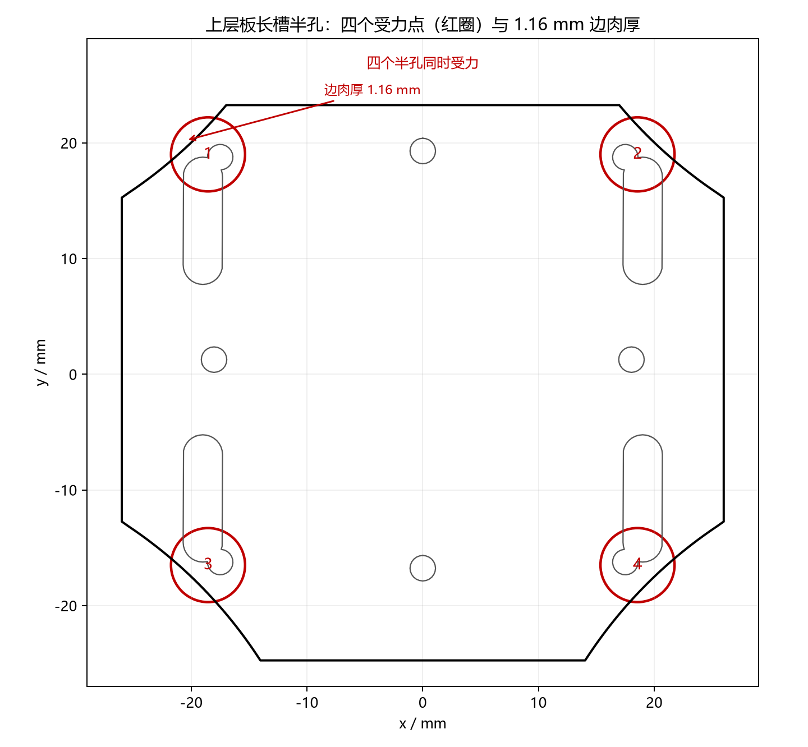

*上层板 4 个长槽外端半孔，边肉厚只有 **1.16 mm**；这是整块上层板最薄的承力边。*


*250 g / 500 g，面内 / 面外，75 g 上板 / 183 g 整机，共 8 个工况。500 g 面外时 75 g 上板约 70 MPa，183 g 整机约 171 MPa。*


*500 g 面外最坏工况的 3D 特写：亮色集中在半孔靠外缘的 1.16 mm 肉厚处。*

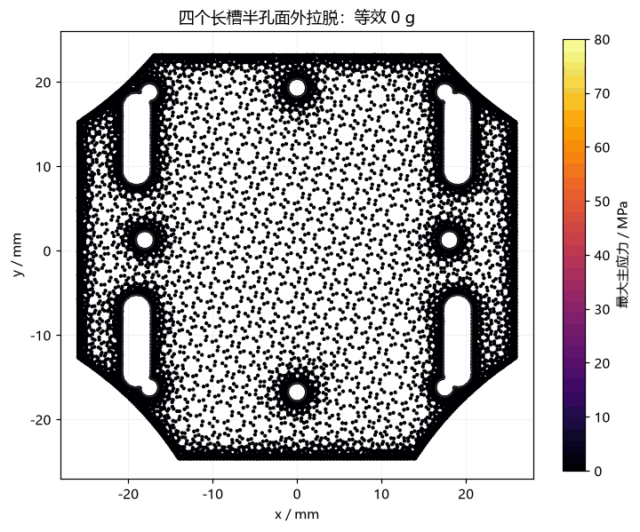

*0 → 500 g 热力图：四个角同时亮；**这 4 个半孔不能当电池/整机的唯一承力点**。*

### 视觉索引（全部图片/动画）

| 文件 | 类型 | 说明 |
|---|---|---|
| `docs/img/z-stack.gif` | GIF | 整机 Z 层叠/装配顺序 |
| `docs/img/z-stack.png` | PNG | Z 层叠静态预览 |
| `docs/img/fc-mount.png` | PNG | 飞控固定/螺丝长度 |
| `docs/img/screw-map.png` | PNG | 底板孔位 → 五金分配 |
| `docs/img/prop-compare.gif` | GIF | 3020-3 vs 3016-3 |
| `docs/img/prop-compare.png` | PNG | 桨对比静态预览 |
| `outputs/cad/v3-preview.png` | PNG | v3 机架俯视预览 |
| `outputs/vibration/f1_materials.png` | PNG | 材料/厚度 vs 一阶频率 |
| `outputs/vibration/campbell.png` | PNG | 一阶模态与 1P/2P/3P 交点 |
| `outputs/vibration/response_vs_rpm.png` | PNG | 1P/3P 响应 vs 转速 |
| `outputs/vibration/mode_shape_compare.gif` | GIF | PLA 3.5 vs 4.0 一阶振型 |
| `outputs/assembly/assembly_mode1_3d.gif` | GIF | 整机第 1 阶 187.6 Hz 3D |
| `outputs/assembly/assembly_mode2_3d.gif` | GIF | 整机第 2 阶 230.2 Hz 3D |
| `outputs/assembly/assembly_mode1_3d_preview.png` | PNG | 整机第 1 阶静态预览 |
| `outputs/assembly/assembly_mode2_3d_preview.png` | PNG | 整机第 2 阶静态预览 |
| `outputs/impact/stack_hole/top_plate_pull_3d.gif` | GIF | stack 孔 3D 应力特写 |
| `outputs/impact/stack_hole/top_plate_pull_3d_preview.png` | PNG | 上面的静态预览 |
| `outputs/impact/stack_hole/top_plate_load_heatmap.gif` | GIF | stack 孔 0→100 N 热力图 |
| `outputs/impact/stack_hole/pull_100N_stress_map.png` | PNG | 100 N 上表面静态应力图 |
| `outputs/impact/stack_hole/pull_stress_vs_force.png` | PNG | 无垫片/Ø5/Ø6 拉脱曲线 |
| `outputs/impact/stack_hole/washer_effect_100N.png` | PNG | 100 N 垫片效果柱状图 |
| `outputs/impact/stack_hole/global_stress_vs_g.png` | PNG | 电池整体压弯 vs g |
| `outputs/impact/frame_arm/frame_arm_50N_3d.gif` | GIF | 底板 FL 臂 50 N 3D |
| `outputs/impact/frame_arm/frame_arm_50N_3d_preview.png` | PNG | 上面的静态预览 |
| `outputs/impact/slot_half_hole/slot_geometry.png` | PNG | 四个半孔位置/1.16 mm 肉厚 |
| `outputs/impact/slot_half_hole/slot_pull_bars.png` | PNG | 8 个半孔工况柱状图 |
| `outputs/impact/slot_half_hole/slot_half_hole_3d.gif` | GIF | 500 g 面外 3D 特写 |
| `outputs/impact/slot_half_hole/slot_half_hole_3d_preview.png` | PNG | 上面的静态预览 |
| `outputs/impact/slot_half_hole/slot_half_hole_heatmap.gif` | GIF | 半孔 0→500 g 热力图 |

---

## 每个部分在讲什么

### [01 · 零件规格](docs/01-零件规格.md)

飞控、电机、摄像头、图传、GPS、接收机、录像模块的实测/官方尺寸和风险点。<br>
**先看**：飞控 25.5×25.5 M2（不是 M3）、电机螺丝最多进 2.5 mm、GPS 反接会烧。

### [02 · 动力与推重比](docs/02-动力与推重比.md)

为什么选 1106 4200KV + 3020-3，而不是 1204 6000KV；3S 650/850mAh 的推重比、电流、悬停油门。<br>
**结论**：主力组合推重比约 **5.5**，满油约 **34 A**；3016-3 是续航备选。

### [03 · 机架设计](docs/03-机架设计.md)

坐标系、135 mm 轴距、22 mm 净空、孔位、螺丝长度、DXF 图层和打印要求。<br>
**注意**：设计图纸底板 3.5 mm；实际分析/打印的 STL 底板是 **4.0 mm**，上层板 3.0 mm。

### [04 · 接线与配置](docs/04-接线与配置.md)

飞控 UART 分配、GPS、图传、录像模块的 PINIO 触发、防反接和 Betaflight 参数。<br>
**结论**：UART1 给 GPS；录像模块的 `AVI`/`JPG` 是对地短接触发，不是视频/照片信号。

### [05 · 采购与预算](docs/05-采购与预算.md)

实际买了什么、五金怎么配、哪些能省、哪些不能省。<br>
**结论**：M2×6 ×28 + M2×4 ×4；支撑柱 22 mm；电机螺丝别买长。

### [06 · 避坑清单](docs/06-避坑清单.md)

已经踩过和差点踩的坑：AVI/JPG 触发脚、GPS 反接、电机螺丝顶线圈、图传没安装孔、PLA/PETG 选择。<br>
**建议**：装之前先翻一遍，能省很多返工。

### [07 · 振动与打印材料方案](docs/07-振动与打印材料方案.md)

机臂模态、材料/厚度、1P/3P 响应、PLA 4.0 打印参数、桨动平衡、飞控软装和滤波。<br>
**结论**：PLA 4.0 mm 一阶约 **151 Hz**；不用买碳纤维；真正的大头是桨不平衡和低油门共振区。

### [08 · 冲击与螺丝拉脱](docs/08-冲击与螺丝拉脱.md)

上层板 stack 孔拉脱、垫片对比、整体弯曲、底板臂根 50 N 电机载荷。<br>
**结论**：前侧 stack 孔 1000 g 等效约 35 MPa，必须加 Ø5–6 垫片；底板臂根/菱形角更危险，要倒圆 + 加筋。

### [09 · 长槽半孔拉脱](docs/09-长槽半孔拉脱.md)

4 个长槽半孔在 250 g / 500 g、面内 / 面外、75 g 上板 / 183 g 整机下的拉脱。<br>
**结论**：500 g 面外 75 g 上板约 **70 MPa**，183 g 整机约 **171 MPa**；不能作唯一承力点，建议 2 mm 加强环/凸台或改扎带路径。

### [10 · 整机装配模态](docs/10-整机装配模态.md)

6 个壳体粘接成整机，全 PLA，带电机/电池集中质量的自由-自由模态；网格 0.7/1.6 mm，86,053 节点 / 384,776 四面体。<br>
**结论**：整机第 1/2 阶 **187.6 / 230.2 Hz**，正好落在悬停 1P 附近；单根机臂模型没有暴露这些整机/stack 模态。必须量实际悬停 RPM + 黑匣子 FFT 确认。

---

## 关键尺寸速查

坐标系：**原点 = 机架中心，单位 mm，X = 左右，Y = 前后（+Y 朝机头），Z = 向上**。

| 项目 | 数值 |
|---|---|
| 轴距（对角电机中心） | **135 mm** |
| 相邻电机中心距 | 95.46 mm |
| 电机孔位 | 9×9 方形，4×M2 → Ø2.2 |
| 飞控孔位 | 25.5×25.5，**旋转 45°** → (±18.03, 0) / (0, ±18.03)，Ø2.2 |
| 中心板 | 八边形，对边 44 mm |
| 板厚 | 设计图 3.5 / 3.0；分析用 STL **4.0 / 3.0** mm |
| 上下板净空 | **22 mm**（= 支撑柱长度） |
| 桨盘余量 | 外沿距电机中心 ≥40.10 mm（桨半径 38.1，余量 2 mm） |
| 相机到上层板余量 | 2.5 mm |
| 打印件重量（PLA） | 底板约 25.4 g / 上层板约 7.8 g / 托架约 2.4 g |
| 推荐打印 | **PLA 4.0 mm 机臂**；5–6 层蒙皮、5 圈壁、60–80% gyroid，机臂根部 100% |
| 一阶机臂模态 | PLA 4.0 ≈ **151 Hz**；PLA 3.5 ≈ 125 Hz |
| stack 孔拉脱 | 前侧孔最弱：Ø5 垫片 100 N 约 19 MPa；1000 g 等效约 35 MPa |
| 最危险冲击位置 | **底板臂根/菱形尖角**；50 N 电机载荷时臂根名义约 43 MPa |
| 长槽半孔 | 边肉厚 **1.16 mm**；500 g 面外 75 g 上板约 70 MPa，不能作唯一承力点 |

---

## 买什么 / 怎么装（速查）

| 问题 | 答案 |
|---|---|
| 电机 | **1106 4200KV**（3 寸用 4000–5000KV；6000KV 是 2–2.5 寸） |
| 桨 | 主力 **Gemfan 3020-3，1.5 mm 孔**；续航备选 3016-3；两种不能混装 |
| 电池 | 3S 650mAh ≥45C；长续航 3S 850mAh 70C（XT30 约 30A 上限） |
| 推重比 | 3020 + 650mAh ≈ **5.5**；3016 + 850mAh ≈ 3.8 |
| M2 螺丝 | **M2×6 ×28** + **M2×4 ×4**；电机螺丝只能用 M2×6 |
| 支撑柱 | **M2 母母 22 mm ×4**（不是 25mm） |
| 飞控固定 | 5 mm 尼龙母母柱垫高；下面 M2×6、上面 M2×4 |
| stack 加强 | **Ø5–6 钢垫片**上下都加；前侧孔最好加局部凸台 |
| 底板加强 | 菱形四角 **R2–3**；臂根加 **3 mm 厚、8–10 mm 高三角筋** |
| 长槽半孔 | 加 2 mm 加强环/凸台，或改扎带路径；不要只靠 1.16 mm 薄边 |
| 电池线 | 18AWG；20AWG 在 30A 上掉 0.3–0.5V |
| GPS | 115200、10Hz；5V 供电，注意防反接 |
| 录像模块 | `AVI`/`JPG` 对地短接；用 2N7002 + PINIO 控制 |
| 图传 | 裸板无安装孔，靠扎带；天线配 RP-SMA 弯头 |

---

## 目录结构

```
fpv/
├── README.md                 项目总览（你在这里）
├── fusion_mcp.md             Fusion MCP 工程规范
├── docs/                     01–10 设计/分析文档
│   ├── 01-零件规格.md
│   ├── 02-动力与推重比.md
│   ├── 03-机架设计.md
│   ├── 04-接线与配置.md
│   ├── 05-采购与预算.md
│   ├── 06-避坑清单.md
│   ├── 07-振动与打印材料方案.md
│   ├── 08-冲击与螺丝拉脱.md
│   ├── 09-长槽半孔拉脱.md
│   ├── 10-整机装配模态.md
│   └── img/                  文档配图（z-stack / fc-mount / screw-map / prop-compare）
├── outputs/                  可直接看的结果
│   ├── cad/                  v3 DXF/STL/预览 + 旧版 archive
│   ├── vibration/            模态、Campbell、响应、振型动画
│   ├── assembly/             整机装配模态、3D 振型动画
│   ├── impact/               stack 孔、臂根、长槽半孔
│   └── archive/              旧版仿真（只作历史对照）
├── ref/                      参考资料图（飞控/GPS 官方图）
└── work/                     本地脚本与中间件（不进仓库）
```

更细的文件说明：

- [`outputs/README.md`](outputs/README.md) — 结果目录地图
- [`outputs/cad/README.md`](outputs/cad/README.md) — CAD 文件
- [`outputs/vibration/README.md`](outputs/vibration/README.md) — 振动结果
- [`outputs/assembly/README.md`](outputs/assembly/README.md) — 整机装配模态
- [`outputs/impact/README.md`](outputs/impact/README.md) — 冲击/拉脱结果
- [`docs/img/README.md`](docs/img/README.md) — 文档配图

---

## 仿真怎么做的 / 这些图能信到什么程度

- 软件：**SfePy 2026.3**，线性弹性 / 无阻尼模态。
- 模态：机臂 45 × 14 × t mm，根部固定，末端 8.5 g；Q2 六面体，shift-invert 求最低 5 阶；与解析梁和工具箱自带求解器交叉验证。
- 整机模态：`drone.stl` 的 6 个壳体 + 4 个夹紧环，0.7/1.6 mm 四面体，86,053 节点 / 384,776 四面体；自由-自由，前 6 阶刚体模态丢掉。
- 冲击：线性静力**冲击等效**，把 250 g / 500 g / 1000 g 换成等效节点力；不是瞬态落摔/接触仿真。
- 材料：PLA E = 3.3 GPa、ν = 0.35、ρ = 1240 kg/m³，是**各向同性筛选值**，不是本机打印件实测。
- 表格/数值：优先看 `outputs/vibration/summary.json`、`outputs/impact/summary.json` 和各自的 CSV；动画里的颜色是应力，变形有放大倍数标注。

**不能从这些图得到的结论**：飞控闭环耦合、真实阻尼、真实桨不平衡量、落摔时的接触力；整机模态里的 1 mm 夹紧环是假设，柱材料也要按实物确认。<br>
**必须做的验证**：桨动平衡 → 挂重 → 0.5 m/1 m 落摔 → 黑匣子/手机 FFT。仿真只负责提前告诉你“哪里最可能先坏”。

---

## 下一步

1. **改 CAD 薄弱处**：上层板前侧 stack 孔加局部凸台/大垫片，4 个长槽半孔加 2 mm 加强环，底板菱形四角 R2–3、臂根加三角筋。
2. **打印**：PLA、平躺、5–6 层蒙皮、5 圈壁、60–80% gyroid；机臂根部/电机座 100%。
3. **装配**：照 z-stack 动画走；M2 螺丝不要暴力拧，stack 孔上下加 Ø5–6 垫片。
4. **测试**：桨动平衡 → 挂重 → 0.5 m 草地 → 1 m 草地 → 0.5 m 硬地；先拆桨、用旧电池。
5. **整机模态验证**：量实际悬停 RPM + 黑匣子 FFT，重点看 187/230/557/561 Hz；如果柱子实际是黄铜，重跑黄铜柱变体。
6. **调参**：先目视飞调 PID，再上图传/GPS；换桨或换电池后重跑一次失控返航测试。

---

## 工作约定

- **Fusion 是设计的唯一事实来源**；改模型通过 `fusion_mcp.md` 里的 MCP 工具落到模型上。
- `work/` 是本地脚本和中间件，**不进仓库**；`outputs/` 是结果，文档里的图都从这里或 `docs/img/` 引用。
- 文档配图由 `work/make_doc_assets.py` 生成；仿真图由 `work/vibration_v2/` 下的脚本生成。**改图就改脚本重跑，别手改 PNG/GIF。**
- 任何“安全/不会炸”的结论都要有挂重或落摔验证；仿真结果只作为筛选和加强依据。
