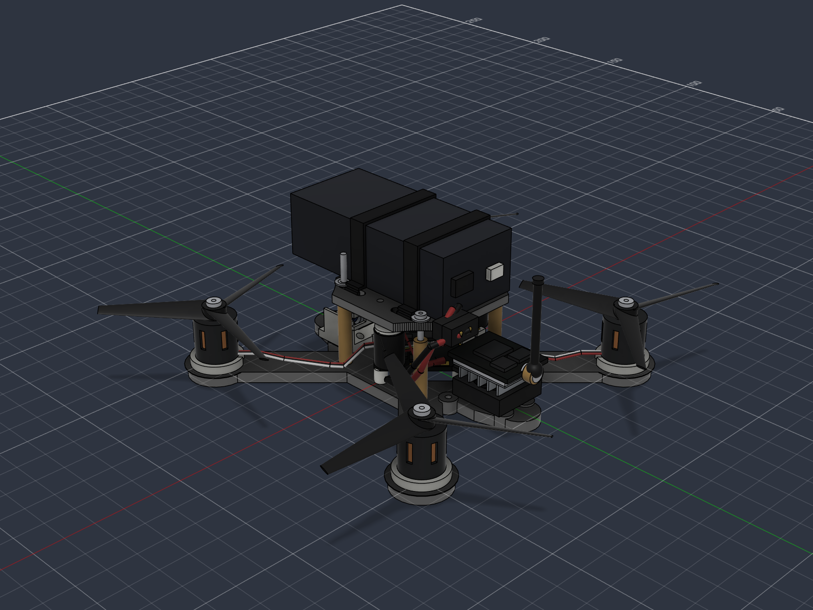

# Kepler V

**一台已经完成设计、打印、装配和首飞的 3 寸 FPV 穿越机。**

这个仓库现在记录正在飞行的版本。旧版机架、早期零件和仿真研究统一放在 [`docs/previous-versions`](docs/previous-versions/README.md)。



## 当前状态

| 项目 | 状态 |
|---|---|
| 机架 | 已设计并打印 |
| 电子件 | 已安装并能正常工作 |
| 首飞 | 已完成 |
| 当前桨叶 | Gemfan 3016-3 |
| 悬停油门 | 约 20% |
| 30% 油门 | 已经快速爬升 |
| 50% 油门 | 近距离飞行很难控制 |
| 下一步 | 调整油门曲线、限制最大输出、继续测试结构 |

首飞时动力明显过剩。20% 左右可以悬停，30% 已经开始快速爬升，50% 以上不适合在狭小空间操作。先把电机输出限制在 70% 到 75%，再围绕实际悬停点调整油门曲线。XT30 和电池在高油门后的温度也要检查。

## 当前配置

| 系统 | 型号 |
|---|---|
| 飞控 | JHEMCU GHF435AIO V2，30 x 30 mm，20 A 四合一电调 |
| 电机 | 1106 4200KV |
| 桨叶 | Gemfan 3016-3 |
| 电池 | 3S LiPo，包络 70 x 31 x 22 mm |
| 图传 | EWRF TS5823 Pro 600 mW |
| 摄像头 | S1039 |
| 接收机 | 板载 ELRS 2.4 GHz |
| GPS | 未安装 |
| 辅助控制器 | KEPLER V CH32V003 模块，通过 UART5 MSP 连接 |

实际打印材料是 PLA。Fusion 材料库没有 PLA，所以模型里的外观材质暂用 ABS 代替，几何尺寸不受影响。

## 当前打印件

| 文件 | 用途 | 数量 |
|---|---|---:|
| [`v5-base-print.stl`](outputs/cad/v5-base-print.stl) | 主底板 | 1 |
| [`v5-top-print.stl`](outputs/cad/v5-top-print.stl) | 上层板 | 1 |
| [`v5-top-layer-spacer-4.5.stl`](outputs/cad/v5-top-layer-spacer-4.5.stl) | 4.5 mm 顶层垫高框 | 1 |
| [`motor-spacer-3mm-four-hole-slot.stl`](outputs/cad/motor-spacer-3mm-four-hole-slot.stl) | Ø18 x 3 mm 电机垫片，带侧面走线槽 | 4 |
| [`v5-vtx-tray-separate.stl`](outputs/cad/v5-vtx-tray-separate.stl) | 独立图传和风扇支架 | 1 |
| [`xt30-cable-clamp-base.stl`](outputs/cad/xt30-cable-clamp-base.stl) | XT30 线夹固定件，含 3.9 mm 六角螺母槽 | 1 |
| [`xt30-cable-clamp-plate.stl`](outputs/cad/xt30-cable-clamp-plate.stl) | XT30 线夹外压板 | 1 |

所有当前 STL 都以打印底面 `z = 0` 导出，并通过水密检查。

## 关键尺寸

| 项目 | 数值 |
|---|---|
| 电机中心 | `x = ±47.73 mm`，`y = ±47.73 mm` |
| 电机孔心 | 正方形边长 6.364 mm，对角 9.000 mm |
| 电机螺丝孔 | Ø2.2 mm |
| 飞控孔位 | 25.5 x 25.5 mm，M2，旋转 45° |
| 底板 / 上层板 | 4.0 / 3.0 mm |
| 加 4.5 mm spacer 后的上下板净空 | 26.5 mm |
| 底板前端相机孔 | 左右孔距 20 mm，两排 y = 22 / 30 mm |
| 相机托架和支架 | 19 mm 孔距，托架孔可左右调节 |

## 装配关系

底板保留标准电机孔，但原来的固定小柱已经移除。每个电机下面放一个独立的 3 mm 圆垫片。每个垫片有四个 M2 孔，两个相邻孔之间开了 4.4 mm 走线槽。

上层板通过一个 4.5 mm 厚的 U 形 spacer 抬高。U 形前端给摄像头 uptilt 留出空间，两侧槽位让电池扎带继续穿过原上层板。

图传支架是独立零件，可以单独拆下和修改。它包含风扇框、VTX 上框、四根立柱、后斜撑和四个 M2 安装点。

XT30 线夹由固定 C 件和外压板组成。固定件挂在顶层后部 `(0, -18.031)` 的 M2 孔下方，内含两个 M2 六角螺母槽。两颗水平螺丝从外侧拧入，把 XT30 线束夹在中间。

## 接线


视频链路是：

```text
摄像头 VIDEO OUT -> 飞控 CAM
飞控 VTX -> 图传黄色 Video in
```

图传红线接电池电压，不能接 5 V。图传橙线输出 5 V，给摄像头供电。白线 Audio in 不使用。飞控 UART5 接 KEPLER V 的 J1。

完整焊盘和线色见 [FC 与图传接线速查](docs/15-FC与图传接线速查.md)。

## 首飞记录

第一次试飞使用 3016-3 桨叶。满电 3S 悬停点大约在 20% 油门，30% 已经快速上升。这个动力水平很适合户外机动飞行，但室内和首次调参时要限制输出。

建议先把电机最大输出限制到 70% 到 75%，再把油门 expo 调到实际悬停点附近。每次落地后检查电池、XT30、电机和电调温度。想要更柔和的手感，也可以先用 2S 电池试飞。

## 打印建议

机架至少使用 4 圈壁，5 到 6 层顶底，60% 到 80% gyroid。机臂根部和安装孔附近增加填充。电机垫片和 XT30 线夹的孔位要保持完整，不要把墙做薄。

切片前确认模型方向。当前 STL 都已经放在打印坐标里。

## 目录

| 路径 | 内容 |
|---|---|
| [`docs/`](docs/) | 当前设计、接线、零件、OSD 和辅助模块 |
| [`docs/previous-versions/`](docs/previous-versions/) | V1 到 V4、旧版 Fusion 图和仿真资料 |
| [`outputs/cad/`](outputs/cad/) | 当前可打印 STL |
| [`outputs/previous-versions/`](outputs/previous-versions/) | 旧版 CAD 和仿真结果 |
| [`outputs/osd_font/`](outputs/osd_font/) | 中文 OSD 字库 |
| [`outputs/osd_logo/`](outputs/osd_logo/) | 开机 Logo BMP |
| [`ref/`](ref/) | 厂商参考资料 |
| [`tools/`](tools/) | OSD 字库和 Logo 工具 |

## 辅助控制器

CH32V003 辅助板在独立仓库：

<https://github.com/Mudycrafter-rubbish-coder/kepler-v-acm>

本地接口说明见 [KEPLER V 辅助控制模块](docs/14-KEPLER%20V辅助控制模块.md)。

## 安全

这是实验性 DIY 飞机。测试接线和固件时先拆桨。图传开机前必须接天线。处理锂电池时要有人在旁边，并且不要把损坏的电池继续装机。

仓库目前还没有许可证文件。用于商业用途或二次发布前请先确认授权。
