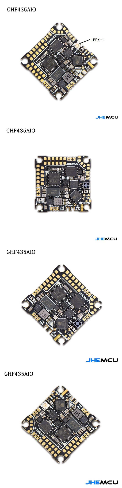
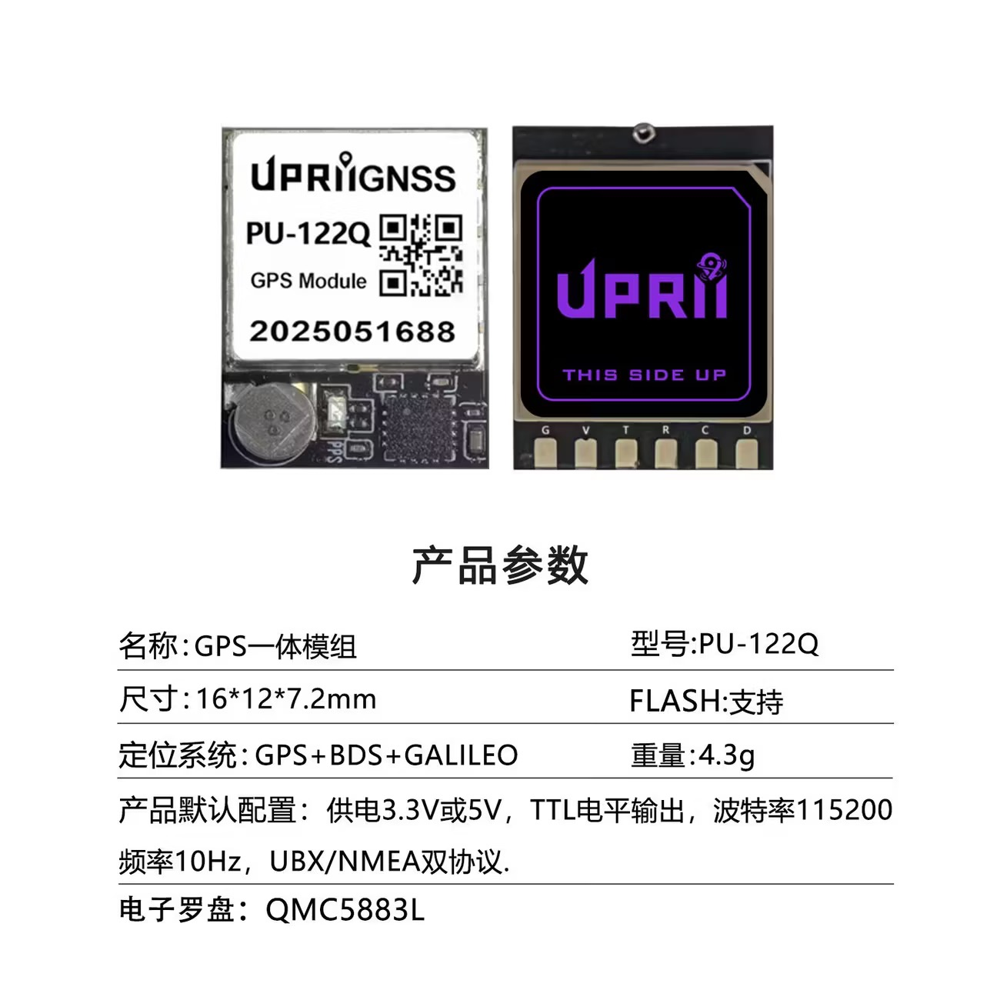

# 零件规格

所有尺寸优先用**官方数据或实测**，来源标注在每条后面。✗ 标记的是风险点。

> **2026-10 更新**：零件已采购。五金按实配改过（[05-采购与预算](05-采购与预算.md)），
> 螺丝长度怎么分配见 [03-机架设计](03-机架设计.md) 的层叠图。

## 飞控 / AIO — JHEMCU GHF435AIO V2

| 项目 | 数值 |
|---|---|
| MCU | AT32F435（288MHz） |
| 陀螺 | ICM-42688-P |
| OSD | AT7456E |
| 电调 | **AM32 4-in-1，每路持续 20A**，ESC MCU = AT32F421 |
| 供电 | **2–4S** |
| 板载接收机 | ELRS 2.4G（占 UART2，`betafpv.rx_2400.lite`） |
| 其他 | 气压计、16MB blackbox、电流/电压传感器、Micro USB + DFU |
| 接口 | **UART1 / UART2 / UART3 / UART5**、WS2812 灯带、蜂鸣器 5V |
| 板尺寸 | 30 × 30 mm（板厚约 1.6 mm） |
| 安装孔 | **25.5 × 25.5 mm，M2**（孔径按 Ø2.2 打） |
| 固定方式 | 4 颗 **M2×6** 从底板下面拧进 **5mm 尼龙母母柱**，再用 4 颗 **M2×4** 穿过飞控板压住 |
| 固件目标 | `JHEF435` |

**风险点**：卖家页有标"25.5×25.5 **M3**"的，是错的 —— 官方与 DarwinFPV 同规格都写 M2。

## 电机 — 1106 4200KV

| 项目 | 数值 |
|---|---|
| 定子 | 11 × 6 mm（体积 66，比 1204 的 48 大 37%） |
| 安装孔 | **9 × 9 mm 方形，4×M2** |
| 轴 | 1.5 mm |
| 底径 | 14.6 mm |
| 高度 | 14.5 mm（不含轴） |
| 螺丝 | **进电机最深 2.5 mm**，再长顶到线圈 ✗ |

**为什么是 4200KV**：见 [02-动力与推重比](02-动力与推重比.md)。3 寸必须 4000–5000KV 档。

**螺丝怎么选**：底板 3.5 + 电机最多进 2.5 → **只能用 M2×6**（M2×5 是很多电机的原厂规格，
但这次套装里没有；M2×4 只咬 0.5mm，会滑牙）。3D 打印板厚实测常在 3.4~3.7 之间飘，
**超过 3.6 必须垫一片 Ø2.2 平垫**，否则就顶到线圈。

## 桨 — Gemfan 3020-3（主力）+ 3016-3（长续航备选）

| | **3020-3** | **3016-3** |
|---|---|---|
| 螺距 | 2.0" | 1.6" |
| 重量 | 1.3 g | 1.1 g |
| 中心孔 | **必须 1.5mm**（另有 2mm 版 ✗） | **必须 1.5mm** |
| 安装 | T-mount | T-mount |
| 买几支 | **8 支**（2 套） | **4 支**（1 套） |
| 定位 | 有劲、抗风、响应快 | 电流小 20%、手感柔、续航 ≈ +8% |

**容易买错**：3020-3 有 1.5mm / 2mm 两种中心孔；3016-3 当年是"designed specifically for 1104"，
配 1106 属于"省电的偏门用法"，能用但不是它的设计点；3028-3 是给更大定子的，别买。
两种桨**不能混装**（一侧一种会抖）。

## 电池 — 3S 650mAh（基准）/ 3S 850mAh 70C（长续航）

| 项目 | 数值 |
|---|---|
| 规格 | 3S（11.1V），XT30 + JST-XH 平衡头 |
| 容量 | 650mAh 基准（≈60 g）；850mAh 长续航（≈85 g） |
| 放电 | 650 ≥45C（标称 29A）；**850 70C 标称 59.5A，按 60~70% 折算 36~42A** |
| 真正的瓶颈 | **XT30 连续只有约 30A**（瞬时 60A）——先卡接头，再卡电池 |

**判断标准**：满油四颗峰值 30~40A。**算电流用 C × 容量**，廉价电池按标称的 60~70% 折算。
所以 850mAh 那包标称的 59.5A 只是个数 —— 真正能用的是 XT30 和线径给你的那 30A。

## 图传 — EWRF TS5823 Pro 600mW

| 项目 | 数值 |
|---|---|
| 尺寸 / 重量 | 30 × 20 × 8 mm / 5 g |
| 供电 | DC 7–24V（3S 直供） |
| 接口 | RP-SMA，40CH |
| 电流 | 600mW 版约 230mA @12V |
| 附加 | 带 5V 输出（可给摄像头供电）、数字显示、过热保护 |
| **安装孔** | **没有** ✗ 裸板，只能扎带/双面胶 |

天线接口是横置的，**要配一根 RP-SMA 弯头或延长线**把天线竖起来（见 [06](06-避坑清单.md) 第 12 条）。

## 摄像头 — S1039（FPV 主摄）

10 × 10 × 11.7 mm，3–5V / 64mA，1200TVL，PAL，130° FOV，约 3 g。
**孔位查不到可靠资料** ✗ → 用扎带压紧的托架；备件面板（`outputs/cad/archive/v2-camera-faceplate.dxf`）
带 14×14 / 19×19 双标准孔，将来换标准摄像头可用。

## 眼镜 — DMKR 008D Pro

| 项目 | 数值 |
|---|---|
| 屏幕 | 4.3" 800×480，500 cd/m²，16:9 |
| 接收 | 内置 40CH，**含 RaceBand**（A/B/E/F/R 各 8 通道） |
| 天线 | **2 × RP-SMA**，可更换 |
| 电池 | 3.7V / 2000mAh，Micro USB（支持 5–23V 宽压） |
| DVR | TF 卡，AVI，30fps；**AV 输入的画面不能录** |
| 重量 / 尺寸 | 300 g（不含天线）/ 155×144×113 mm |
| 备注 | 接收机不可拆换，但支持外接 VRX 走 AV in；屏幕可拆下当监视器 |

说明书在 `work/vendor/dmkr-008d-pro-manual.pdf`（已转 PNG）。

## GPS — UPRiiGNSS PU-122Q

| 项目 | 数值 |
|---|---|
| 尺寸 / 重量 | **16 × 12 × 7.2 mm / 4.3 g** |
| 星座 | GPS + 北斗 + Galileo |
| 更新率 | **10 Hz** |
| 波特率 | **115200**（不需要改 9600） |
| 供电 | 3.3V 或 5V |
| 协议 | UBLOX / NMEA 双协议 |
| 其他 | 带 QMC5883L 电子罗盘、备份电池、FLASH |

**注意**：罗盘一般不用（Betaflight 的 GPS Rescue 不依赖它），而且机尾距电机仅约 30 mm，
磁干扰不小 —— 要用就得校准并接受漂移。模块直接卡进底板的卡槽（深 2.0，见 [03](03-机架设计.md)）。

## 录像模块 — OV2640 + DVR（拆机，3 g）

| 项目 | 数值 |
|---|---|
| 焊盘 | `+` `-` `AVI` `JPG`（另有 `UART`） |
| 功能 | **AVI = 录像触发，JPG = 拍照触发** |
| 触发方式 | **对地短接**（低电平有效，松手触发） |
| **视频输出** | **没有** ✗ 纯录像机，不能当 FPV 摄像头 |
| 供电 | 实测 5V 能用 |

**历史坑**：丝印是 `AVI` 不是 `AV1` —— 一字之差，害我们绕了两轮。另外曾反接电源（限流 100mA）把它烧死一颗。

## 五金（2026-10 实配）

**螺丝套装**（已购）：M2×4 / ×6 / ×8 / ×10 / ×12 / ×14 / ×16 / ×18 / ×20 **各 10 颗**，
外加 **M2 螺母 20 颗**。套装里 ×6 只有 10 颗，而整机要 28 颗 → **另外补买 M2×6 ×20**。

| 用在哪 | 长度 | 数量 | 穿过 / 咬合 |
|---|---|---|---|
| 电机 4 颗 | **M2×6** | 16 | 穿底板 3.5，进电机 2.5（上限） |
| 支撑柱 ↔ 底板 | **M2×6** | 4 | 穿底板 3.5，咬柱 2.5 |
| 支撑柱 ↔ 上层板 | **M2×6** | 4 | 穿上层板 3.0，咬柱 3.0 |
| 飞控 ↔ 尼龙柱（下） | **M2×6** | 4 | 穿底板 3.5，咬尼龙柱 2.5 |
| 飞控 ↔ 尼龙柱（上） | **M2×4** | 4 | 穿飞控板 1.6，咬尼龙柱 2.4 |
| 相机托架 | — | 0 | 用 2.5mm 扎带（Ø2.6 孔 ×4） |
| **合计** | M2×6 ×28、M2×4 ×4 | 32 | 套装剩的 ×8~×20 留给以后改装 |

**其他五金**：

- **支撑柱：M2 母母 22mm ×4**（黄铜/铝/尼龙都行；**不是 25mm**）
- **M2 尼龙母母柱 5mm ×4**（飞控垫高，避开板底元件）
- Ø2.2 平垫若干（电机那 16 颗用来压进给量）
- XT30 公母 1~2 对、470µF 低阻电容 ×1（+1 备用）、18AWG 硅胶线、热缩管
- 2.5mm 扎带、电池扎带（10mm 魔术贴）、RP-SMA 弯头、5V 有源蜂鸣器

## 遥控器

需要 **2.4G ELRS** 发射机与板载接收机匹配（已采购；型号以实物为准，文档里不记）。
这台机没有外置接收机，遥控器的协议、频段、通道映射都要跟板载 ELRS 对上。

## 充电器 — B3（已有 / ¥20）

2S/3S 平衡充，固定 0.8~1.2A，**无显示、无存储模式、无温控** ✗。
必须配：**电池电压表（¥15）+ LiPo 防爆袋（¥15）**，并且**绝不允许无人值守充电**。
850mAh 那包在 1A 下要一个多小时，B3 只有平衡头输出，不需要 XT30 转接线。
