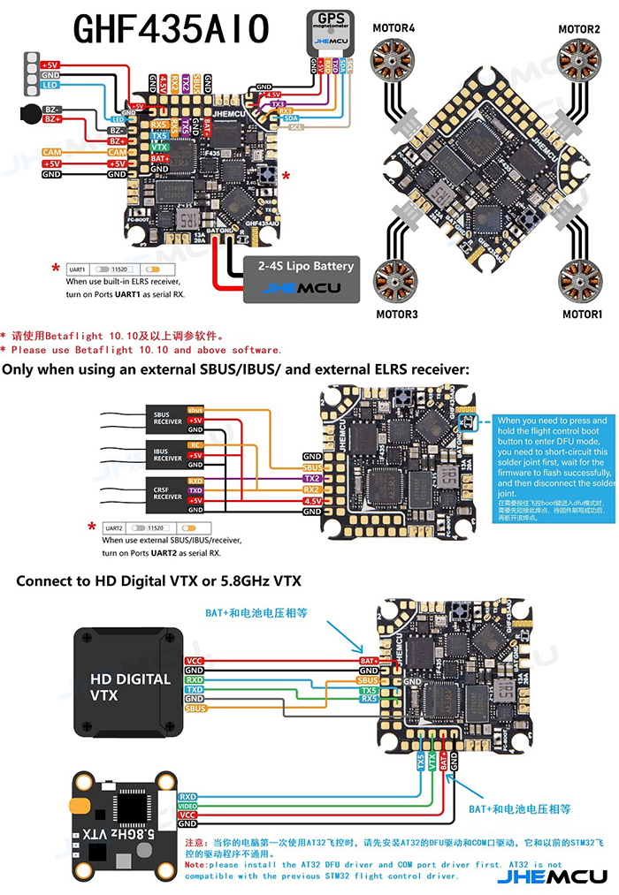

# 接线与配置



## 飞控引脚分配

GHF435AIO V2 的可用资源：

| 资源 | 状态 | 用途 |
|---|---|---|
| UART2 | 被板载 ELRS 占用 | 固定 |
| UART1 | 空闲 | → **GPS** |
| UART3 | 空闲 | RX → 录像模块 UART（可选），TX 释放给 PINIO |
| UART5 | 空闲 | TX 释放给 PINIO |
| LED（WS2812） | 空闲 | 挂灯带，或改 PINIO |
| 蜂鸣器 5V | 空闲 | **建议保留**（户外找机） |
| 电流/电压传感 | 已接电调 | 固定 |

**注意**：AT32F435CG 是 48 脚封装，GPIO 总共三十几个，陀螺/OSD/气压计/黑匣子/ELRS/USB/四路电机已经吃掉大半。**能自由支配的就是手册引出来的那几个焊盘**，不存在"板上一堆闲置 GPIO"。

**找空闲引脚的方法**：Betaflight CLI 里敲 `resource` 看现状，`resource show all`（固件支持的话）看每个引脚支持的全部功能。

## 飞控怎么固定（五金）


飞控装在底板中央，45° 摆放，孔位 (±18.03, 0) / (0, ±18.03)：

- 底板下面 4 颗 **M2×6** 向上拧进 **5mm 尼龙母母柱**（垫高是为了避开板底的元件和焊点）
- 飞控板上面 4 颗 **M2×4** 穿过板上孔位压住（咬尼龙柱 2.4mm）

垫高 5mm 之后，底板那个可选的 1.5mm 元件避让凹槽（`POCKET_OPT_1.5DEEP`）**就不用切了**。

## PINIO（控制录像模块的两种触发）

录像模块的两个触发脚都是**对地短接**有效，所以**必须用开漏下拉**，不能给电平：

```
飞控 PINIO ──1k── 2N7002 栅极(G)
               漏极(D) ── 模块触发脚
               源极(S) ── GND
```

```
resource SERIAL_TX 3 NONE
resource PINIO 1 <UART3 TX 引脚名>
resource SERIAL_TX 5 NONE
resource PINIO 2 <UART5 TX 引脚名>
set pinio_box = 40,41,255,255      # PINIO1→AUX1, PINIO2→AUX2
```

引脚名以你板子的 `resource` 输出为准。

**关键限制**：PINIO 直接跟随开关状态，**飞控不会替你生成脉冲**。而模块认的是"按下再松开"这个动作 —— 所以映射到**瞬时开关（momentary）**最自然：拨住不放、松手触发。

## 各部件接线

| 部件 | 接到 | 说明 |
|---|---|---|
| 电机 ×4 | AIO 电机焊盘 | 顺序按 Betaflight 的 resource 映射 |
| 图传 | **VBAT 直供**（7–24V） | 不占 5V；记得接天线，不接会烧 |
| 摄像头 | 5V + GND + 视频入 | 也可从图传的 5V 输出取电 |
| GPS | UART1 的 TX/RX + 5V + GND | 3.3V 或 5V 都行；**115200，不要改 9600** |
| GPS 罗盘（QMC5883L） | I2C（可选） | 一般不用，机尾离电机仅约 30 mm |
| 录像模块 | 5V + GND + `AVI`/`JPG` 经 MOS + UART(可选) | 见上一节 |
| 蜂鸣器 | 蜂鸣器焊盘 | **该焊盘可能是 5V 甚至 VBAT 开关**，绝不能当逻辑脚接输入设备 |

## 供电、电容与线径

| 项目 | 规格 | 说明 |
|---|---|---|
| 电池引出线 | **18AWG 硅胶线** | 满油峰值 34A，20AWG 在 30A 时掉 0.3~0.5V，太亏 |
| 电容 | **470µF 低阻，1 颗**（并联在电池焊盘） | 至少 220µF；3S + 600mW 图传 + AIO 没有电容会加速掉压 |
| 反接保护 | **SS14 肖特基**串在电源入口 | 正向压降 0.3V，反向截止 |
| 接头 | **XT30**（1 对足够，+1 备用） | XT30 连续约 30A —— 这就是为什么 850mAh 70C 也吃不满 59.5A |

只有在**正确极性**下测量：先万用表确认 VCC/GND 没短接。

**上电前用 1kΩ 电阻当探针**：它能拉低任何带上拉的输入脚，但伤不到任何输出脚，是判断"这个焊盘到底是什么"的通用安全手套。

## Betaflight 设置要点

| 项目 | 值 | 说明 |
|---|---|---|
| 串口 | UART1 → GPS；UART2 → Serial RX（内置 ELRS） | 用外置接收机时才把 UART1 设成 RX |
| GPS 协议 | UBLOX 或自动 | PU-122Q 双协议 |
| `gps_update_rate_hz` | **10** | 该模块原生 10Hz |
| 波特率 | **115200** | 模块默认值 |
| `gps_rescue_min_sats` | 8 | 起飞前等到 8 颗以上、HDOP < 2 |
| PINIO | 见上文 | |
| 双向 DShot + RPM 滤波 | 开启 | AM32 支持，免费的手感提升 |

**GPS Rescue 在推重比低时更容易被拦**：返航前飞控会先算需要多少油门，超过 `gps_rescue_throttle_max` 就直接放弃返航。

- 3020-3 + 650mAh：推重比 ≈5.5、悬停 43% → 余量充足
- 3016-3 + 850mAh：推重比 ≈3.8、悬停 51% → **换到这个组合后，飞远前必须重跑一次失控返航测试**

## 电机螺丝（最容易烧机的坑）

底板 3.5 mm + 电机进螺丝**最多 2.5 mm** → **只能用 M2×6**。

| 螺丝 | 露出板面 | 判定 |
|---|---|---|
| M2×4 | 0.5 mm | ✗ 咬不住，会滑牙 |
| **M2×6** | **2.5 mm** | ✓ **正好压在上限上，用这个** |
| M2×7 及以上 | 3.5 mm+ | ✗ **顶到线圈，直接烧电调** |

3D 打印的板厚会飘：**量出来超过 3.6 mm 就垫一片 Ø2.2 平垫**，把进入量压到 2mm 左右。
上螺丝先用手拧，感觉到底就停，千万别用电动起子。

买回来混装的 M2 螺丝，**务必把 7 mm 以上的挑出来别用在电机上**。
