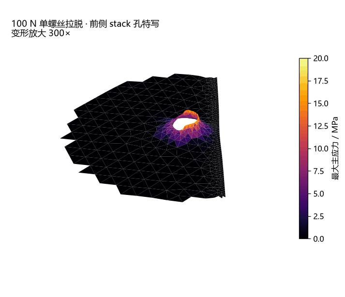
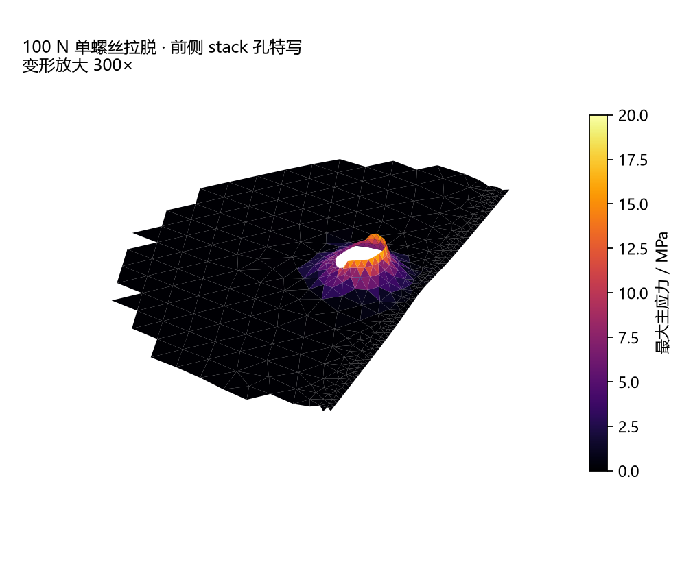
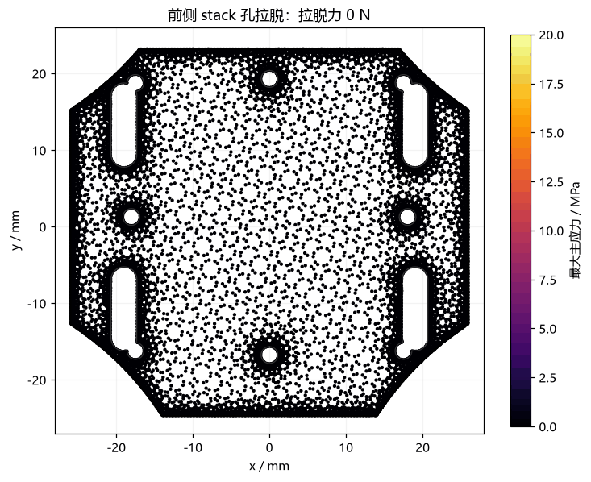
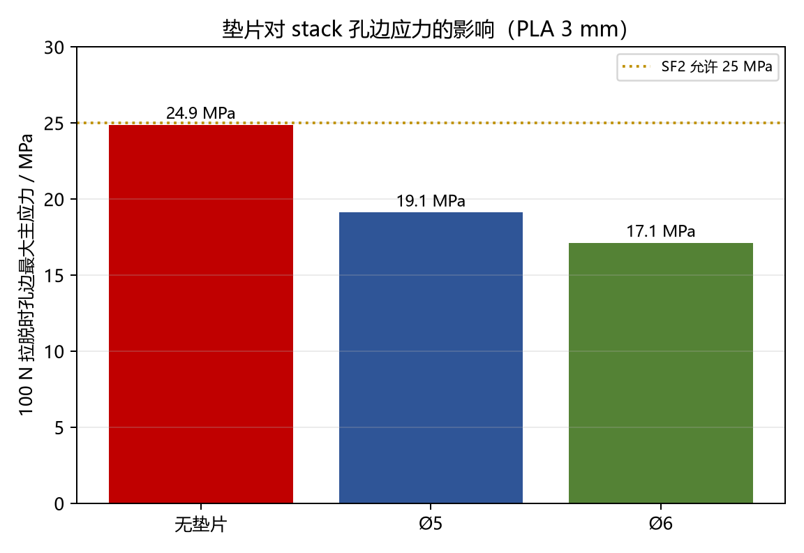
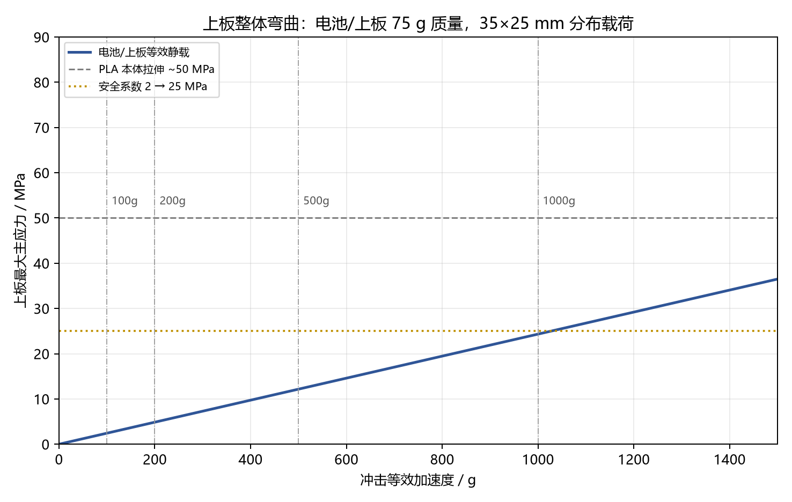
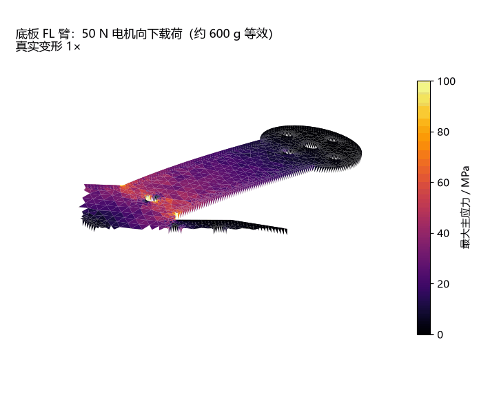
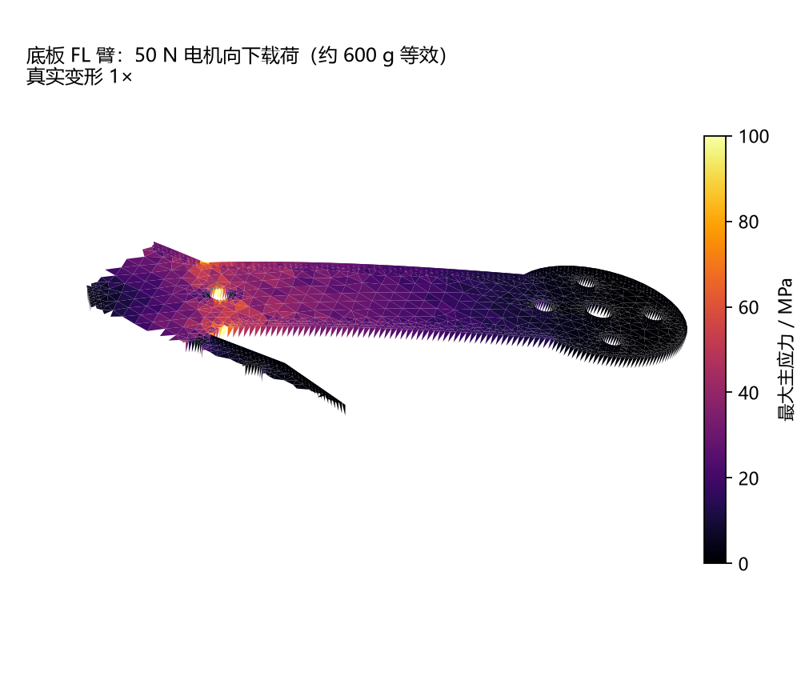

# 08 · 冲击、stack 螺丝与 PLA 强度

> 分析对象：3 mm PLA 上层板（天灵盖）和 4 mm PLA 底板（鸡架）。
> 分析类型：**线性静力冲击等效 + 单螺丝拉脱**；不是瞬态落摔/接触仿真。
> 结论先行：**钢螺丝不会断，断的是螺丝孔周围的 PLA。上层板前侧 stack 孔在 1 m/1000 g 量级冲击下已经接近极限；底板的臂根/菱形角比 stack 孔更危险。**

## 1. 几何量测

从 STL 中面截面量出来的关键尺寸：

| 特征 | 尺寸 | 到自由边最小肉厚 |
|---|---:|---:|
| 上层板 stack 孔（4 个） | Ø2.19 mm | 前侧 **2.87 mm**；其余 6.87 mm |
| 上层板长槽（4 个） | 约 7 × 24 mm | **1.16 mm** |
| 上层板厚度 | 3.0 mm | — |
| 底板侧 stack 孔 | Ø2.19 mm | **2.87 mm** |
| 底板电机座外孔 | Ø2.19 mm | 2.51 mm |
| 底板后部电池槽 | 约 10 × 22 mm | **1.98 mm** |
| 底板厚度 | 4.0 mm | — |

你说的“边边很薄”主要是 **上层板的 4 个长槽（1.16 mm）**；stack 螺丝孔本身的肉厚是 2.87 mm，比长槽厚，但仍然是上层板最弱的螺丝孔。

## 2. 上层板：单螺丝拉脱

### 2.1 3D 特写动画

100 N 向上拉脱、Ø5 垫片、变形放大 300×。亮环就是孔边应力集中；远离孔的区域应力很低。

### 2.2 热力图随拉脱力变化

0→100 N→0 循环；颜色固定在 0–20 MPa。可以看到应力从孔边逐渐长出来。

### 2.3 数值

前侧 stack 孔，4 个底部支撑柱环面固定，顶面环形节点向上拉：

| 垫片 | 100 N 时孔边最大主应力 | 50 MPa 极限载荷 | 25 MPa（SF2）载荷 |
|---|---:|---:|---:|
| 无垫片（头 Ø3.8） | 24.9 MPa | ~201 N | ~100 N |
| **Ø5 钢垫片** | **19.1 MPa** | **~262 N** | **~131 N** |
| **Ø6 钢垫片** | **17.1 MPa** | **~292 N** | **~146 N** |

按 75 g 上板质量、4 颗螺丝均分：

| 冲击 | 单螺丝载荷 | 无垫片 | Ø5 | Ø6 |
|---|---:|---:|---:|---:|
| 300 g | 55 N | 13.7 MPa | 10.6 MPa | 9.4 MPa |
| 500 g | 92 N | 22.9 MPa | 17.6 MPa | 15.8 MPa |
| **1000 g** | **184 N** | **45.8 MPa** | **35.2 MPa** | **31.5 MPa** |

**判断**：正常炸机（300–500 g 量级）没问题；1 m 落摔到硬地（~1000 g）时，无垫片已经接近 PLA 本体强度，Ø5/Ø6 垫片仍在极限以内，但安全系数不到 2。**必须加垫片，最好 Ø6。**

## 3. 上层板整体弯曲

电池/上板 75 g 质量，35 × 25 mm 分布载荷，4 个支撑柱环面固定：

| 冲击 | 最大主应力 |
|---:|---:|
| 100 g | 2.43 MPa |
| 200 g | 4.87 MPa |
| 500 g | 12.2 MPa |
| 1000 g | 24.3 MPa |

整体弯曲远没有单螺丝拉脱危险。**真正的问题不是“电池把板压弯”，而是“上板被螺丝/支撑柱扯住时孔边撕裂”。**

## 4. 底板：stack 孔与臂根

### 4.1 底板 stack 孔

局部 4 mm 模型，侧 stack 孔，Ø5 垫片：

| 载荷 | 孔边最大主应力 |
|---:|---:|
| 100 N | 13.0 MPa |
| 184 N（1000 g 等效） | 24.0 MPa |

4 mm 底板比 3 mm 上层板强不少；同样的 1000 g 量级，底板 stack 孔约 24 MPa，仍低于 50 MPa，但已经到 SF2 边缘。

### 4.2 底板臂根/菱形角：最危险

FL 电机向下 50 N（约 600 g 等效），真实变形 1×：

| 载荷 | 臂根名义最大主应力 | 菱形尖角处 |
|---:|---:|---:|
| 20 N | 17.3 MPa | 44.9 MPa |
| **50 N** | **43.3 MPa** | **112 MPa** |

50 N 时臂根名义应力已经接近 PLA 本体强度 50 MPa；菱形尖角是**几何奇异点**，网格越细数值越高，不能当成真实 112 MPa，但它明确告诉你：**尖角必须倒圆，臂根必须加筋。**

按名义应力：

- SF2（25 MPa）允许约 **29 N** 电机载荷；
- 50 MPa 极限约 **58 N**；
- 1 m/1000 g 作用在 8.5 g 电机上约 **83 N**，静态等效下已经超过极限。

实际炸机有桨、臂、电池和地面的缓冲，不会完全按静态 83 N 走；但**臂根是整台飞机最该加强的地方**，比 stack 螺丝更值得担心。

### 4.3 上层板长槽

长槽边只有 1.16 mm。如果电池扎带从槽里穿过，1000 g 时 4 个槽均分约 184 N/槽，按两个剪切面估算：

\[
\tau \approx \frac{184}{2 \times 1.16 \times 3} \approx 26.4\ \text{MPa}
\]

已经接近 PLA 剪切强度（约 25–30 MPa）。500 g 时约 13 MPa，安全。**如果扎带只吃两个槽，1000 g 直接翻倍，必炸。** 长槽要么倒圆/加厚，要么改扎带路径，别让薄边吃全部拉力。

## 5. 建议的修改

### 上层板

1. **4 颗 stack 螺丝上下都加 Ø5–6 mm 钢垫片**，尤其是前侧 2.87 mm 肉厚的那个孔。垫片比加硬材料便宜得多。
2. 前侧 stack 孔周围加 **1 mm 厚、Ø7–8 mm 的局部凸台/圆角**；如果不想改 CAD，至少用大垫片 + 0.5 mm 铝片垫在螺丝头下。
3. 4 个长槽的边 **R0.8–1 mm 倒圆**；如果槽是扎带路径，加 1 mm 厚的加强环或改走线。
4. 如果整块重打，3 → 4 mm 上层板会把弯曲应力降到约 (3/4)² = 56%；但要同步检查 22 mm 支撑柱、相机托架 Z 偏置和螺丝长度。

### 底板

1. **菱形四个尖角 R2–3 mm 倒圆**；这是最高优先级的几何修改。
2. 四个臂根加 **3 mm 厚、8–10 mm 高的三角加强筋**（左右各一条），或把臂根局部加厚到 4.5–5 mm。目标是把 50 N 时的名义应力从 43 MPa 压到 25 MPa 以下。
3. 电机座外孔 2.51 mm 肉厚处加 Ø5 垫片；M2×6 不要换成更长螺丝（会顶线圈）。
4. 后部电池槽 1.98 mm 边倒圆；如果扎带吃这个槽，加加强片。

### 装配

- M2 螺丝不要暴力拧；PLA 会蠕变，过盈预紧会把孔边压裂。用垫片分散压力。
- 飞完一轮摸电机座；烫手说明 PLA 局部接近软化，长期会松。
- 先打一个 **spare 底板**。臂根是最可能先坏的地方。

## 6. 验证

1. **挂重测试**：上层板前侧孔挂 10 kg（约 98 N）静置 10 分钟，检查孔边白化/裂纹；再挂 15 kg（147 N）看是否屈服。不要直接上 20 kg 以上，PLA 会脆断。
2. **落摔**：0.5 m 草地 → 1 m 草地 → 0.5 m 硬地，逐步来；用旧电池/假电池，先拆桨。每次检查臂根、菱形角、stack 孔和长槽。
3. **黑匣子/手机加速度计**：记录落摔时的峰值 g，回填到本文的载荷表，判断安全系数。

## 7. 局限

- 线性静力，不是瞬态落摔/接触；没有应变率、阻尼、地面反力。
- PLA 各向同性筛选；打印方向、层间强度、缺陷没有实测。
- 螺丝预紧、摩擦、接触没有建模；固定环面比真实螺栓连接更刚。
- 菱形尖角是应力奇异点，数值随网格变化；只用它判断“哪里要倒圆”，不要把它当成真实 112 MPa。
- 真正的结论必须靠挂重/落摔测试确认。

---

### 相关文件

- `outputs/impact/summary.json` — 所有关键数值
- `outputs/impact/key_results.csv` — 表格数据
- `outputs/impact/top_plate_pull_3d.gif` — 上层板孔边 3D 应力
- `outputs/impact/top_plate_load_heatmap.gif` — 上层板拉脱热力图
- `outputs/impact/frame_arm_50N_3d.gif` — 底板臂根 3D 应力
- `work/vibration_v2/static_top_plate.py` — 上层板整体冲击等效
- `work/vibration_v2/pull_top_plate.py` — 上层板单螺丝拉脱
- `work/vibration_v2/frame_pull.py` — 底板 stack 孔局部拉脱
- `work/vibration_v2/frame_arm_static.py` — 底板电机载荷
