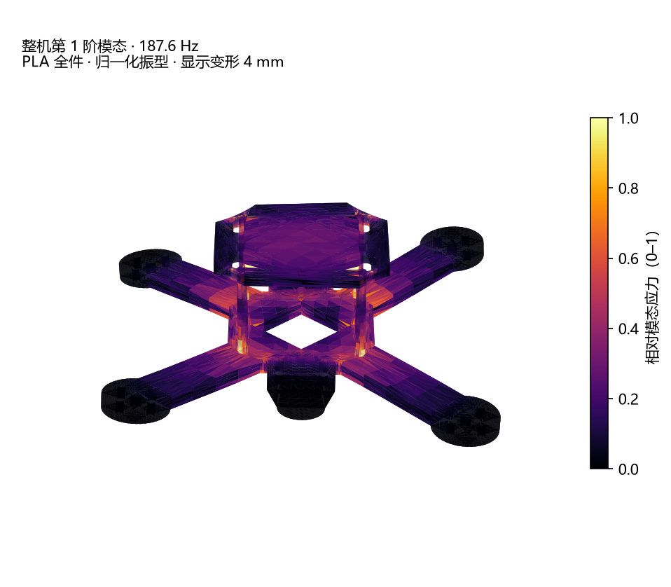
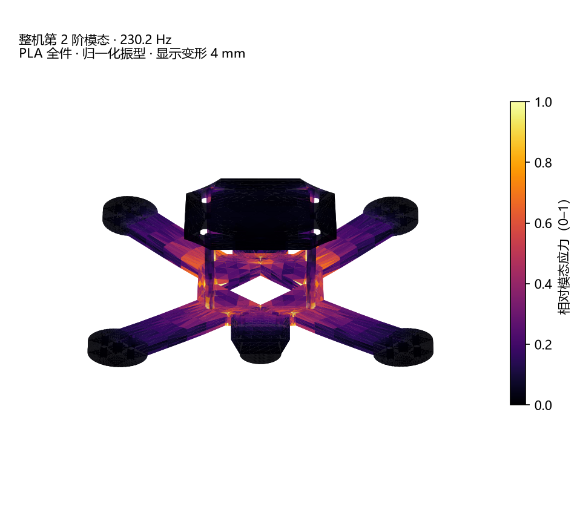

# 10 · 整机装配模态（PLA 全件）

> 对象：`drone.stl` 的 6 个壳体（底板 + 上层板 + 4 根 Ø3×25 柱），全部按 PLA。
> 分析类型：**自由-自由、无阻尼线性模态**；不是整机飞行实测，也不是瞬态落摔。
> 结论先行：整机装配后，前两阶弹性模态 **187.6 / 230.2 Hz** 正好落在悬停 1P（12–15k RPM = 200–250 Hz）附近；这和“只算机臂”的结论不一样，必须用实际悬停 RPM 和黑匣子 FFT 确认。

## 1. 几何与网格

从 `drone.stl` 读出来：

| 项目 | 数值 |
|---|---:|
| 外形 | 115.45 × 115.45 × 29.01 mm |
| 体积 | 27,447 mm³ |
| PLA 质量 | 约 34 g |
| 组成 | 底板 4 mm + 上层板 3 mm + 4 根 Ø3×25 柱 |
| 柱位置 | (±17.5, ±17.5)，从 z=0 穿到 z=25 |

网格不是直接用 STL 的 7,040 个三角形，而是重新生成的四面体：

| 网格（mm） | 节点 | 四面体 | f1 | f2 |
|---|---:|---:|---:|---:|
| 1.0 / 2.2 | 68,809 | 301,770 | 198.66 Hz | 243.75 Hz |
| 0.8 / 1.8 | 79,179 | 351,180 | 186.14 Hz | 228.96 Hz |
| **0.7 / 1.6（最终）** | **86,053** | **384,776** | **187.57 Hz** | **230.18 Hz** |

0.7/1.6 与 0.8/1.8 的 f1 只差 0.8%，可认为网格收敛；粗网格 1.0/2.2 把 f1 高估了约 5.9%。动画表面另外把 STL **subdivide 两次**：**7,040 → 112,640 个三角形**，平面不会只有几个大三角。

## 2. 质量与连接

- 电机：4 × 8.5 g，集中质量放在四个电机中心。
- 电池：60 g，分布在上班 35×25 mm 区域；上板电子再加 15 g。
- 柱顶加 1 mm 厚、Ø6 的夹紧环，代表螺丝/垫片把上层板压住。**这是仿真假设**；如果实际只是柱子穿过长槽、没有夹紧，上层板可能是浮的。
- 板/柱界面粘接；不模拟螺纹、预紧、摩擦、接触。

## 3. 结果

前 6 阶是刚体模态，已丢掉。第 1–8 阶弹性模态：

| 阶 | 频率 | 主要方向 | 1P 交点 | 3P 交点 |
|---:|---:|---|---:|---:|
| 1 | **187.6 Hz** | 电机/机臂 Z（垂直） | 11.3k RPM | 3.75k RPM |
| 2 | **230.2 Hz** | 电机/机臂 Z（垂直） | 13.8k RPM | 4.60k RPM |
| 3 | 276.8 Hz | Z + Y 混合 | 16.6k RPM | 5.54k RPM |
| 4 | 285.4 Hz | Z + X 混合 | 17.1k RPM | 5.71k RPM |
| 5 | 340.9 Hz | Y（横向/扭转） | 20.5k RPM | 6.82k RPM |
| 6 | 416.2 Hz | Z + Y 混合 | 25.0k RPM | 8.33k RPM |
| 7 | 557.0 Hz | Y（横向/扭转） | 33.4k RPM | 11.14k RPM |
| 8 | 561.0 Hz | Z（垂直） | 33.7k RPM | 11.22k RPM |

### 悬停带附近有多近

单自由度放大倍数，取 PLA 阻尼比 ζ=0.015（Q≈33），只作筛选：

| 阶 | 12k RPM 1P | 13k RPM 1P | 14k RPM 1P | 12k RPM 3P | 13k RPM 3P |
|---:|---:|---:|---:|---:|---:|
| 1（187.6） | **8.09** | 3.97 | 2.82 | 0.11 | 0.09 |
| 2（230.2） | 3.06 | **7.55** | **25.0** | 0.17 | 0.14 |
| 7（557.0） | 0.15 | 0.18 | 0.21 | **6.12** | 2.75 |
| 8（561.0） | 0.15 | 0.18 | 0.21 | **6.79** | 2.91 |

这表的意思是：

- 悬停 12k RPM 时，1P 约 200 Hz，正好在 187.6 Hz 上方 6.6%，放大倍数约 8。
- 悬停 13.8k RPM 时，1P 约 230 Hz，正好撞第 2 阶，放大倍数可到 25（无阻尼极限更夸张）。
- 悬停 12k RPM 时，3P 约 600 Hz，正好在第 7/8 阶（557/561 Hz）上方 7–8%，放大倍数约 6–7。

**重要**：这是**单自由度、无阻尼筛选**，不是实测；真实阻尼、螺栓接触、桨的激励方向/幅值都会改变结果。但“频率正好落在悬停带”这个事实必须重视。

## 4. 3D 动画

### 第 1 阶 187.6 Hz

旋转 + 呼吸变形；颜色是相对模态应力（0–1），亮的地方在柱顶/上层板夹紧区和机臂根。振型是归一化的，显示变形 4 mm，不是实际振幅。

### 第 2 阶 230.2 Hz

第 2 阶在 13.8k RPM 附近与 1P 重合，是悬停带里最需要实测的一阶。

## 5. 怎么读 / 下一步

1. **先量真实悬停 RPM**：OSD/黑匣子看悬停油门对应的 RPM，不要用 12–15k 的假设当结论。
2. **黑匣子 FFT**：悬停 + 慢扫油门，看 187/230/557/561 Hz 附近有没有峰；有峰再谈滤波/陷波。
3. **确认柱子材料**：这版是全 PLA；如果实际是黄铜柱，频率会上移，必须按黄铜重跑。
4. **确认夹紧方式**：1 mm 夹紧环是假设；如果上层板只是穿过长槽、没有螺丝/垫片压住，上层板可能参与更低频的局部模态。
5. **加强/阻尼**：如果实测确认 187/230 Hz 有峰，优先考虑上层板/柱的夹紧刚度、飞控软装和桨动平衡；不要只加固定陷波。
6. **下一步仿真**：黄铜柱变体、整机 250/500/1000 g 冲击等效。

## 6. 局限

- 全 PLA 各向同性筛选；不是打印件实测。
- 柱顶 1 mm 夹紧环是假设，真实螺丝/垫片接触没有建模。
- 自由-自由模态，没有飞控、桨、线材、电池绑带的真实连接。
- 单自由度放大倍数只用于筛选；没有实测阻尼和激励幅值。
- 振型幅值是归一化的，不能当实际振动毫米数。

---

### 相关文件

- `outputs/assembly/modal_summary.json` — 网格收敛、质量、假设、结论
- `outputs/assembly/mode_frequencies.csv` — 8 阶频率/方向/交点/放大倍数
- `outputs/assembly/assembly_mode1_3d.gif` — 第 1 阶 3D
- `outputs/assembly/assembly_mode2_3d.gif` — 第 2 阶 3D
- `work/full_assembly/mesh_drone_assembly.py` — STL → 粘接四面体
- `work/full_assembly/modal_all_pla.py` — 自由-自由模态
