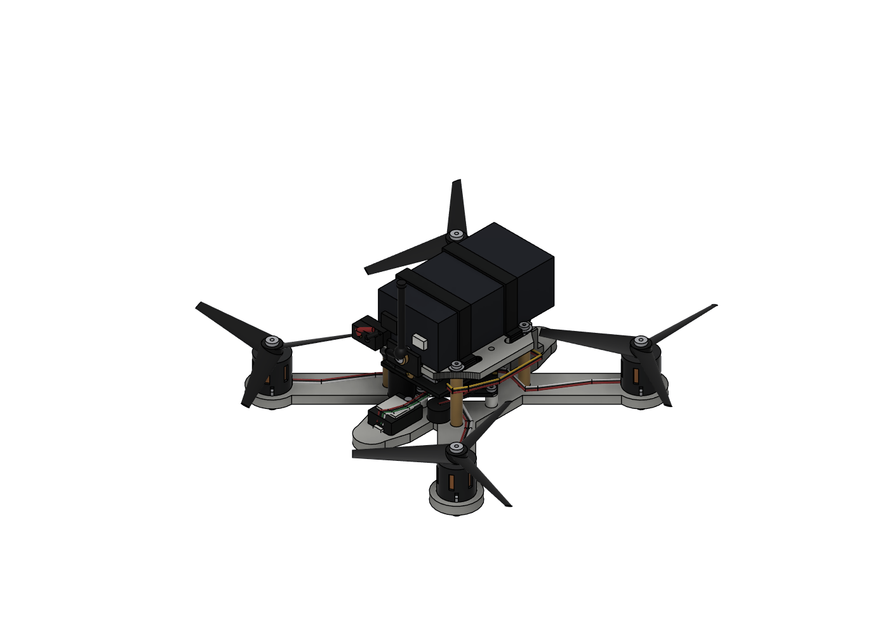
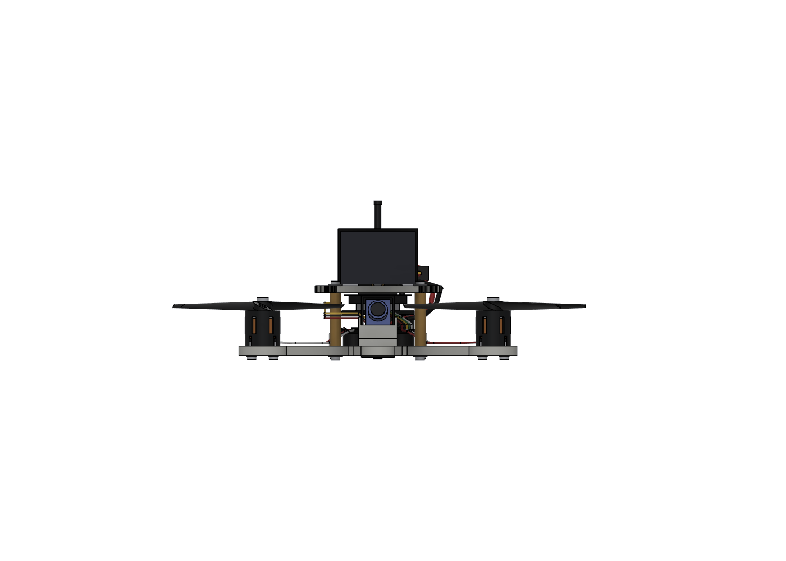
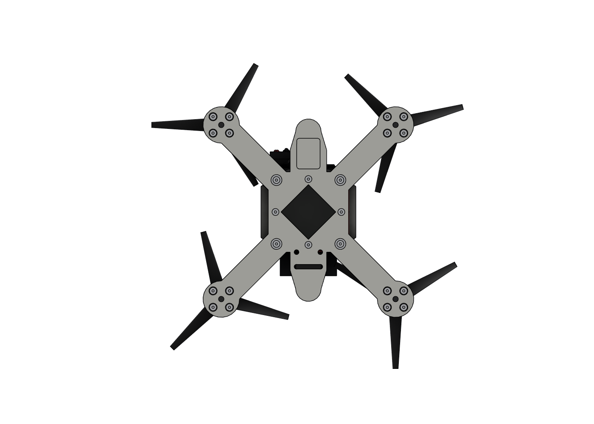
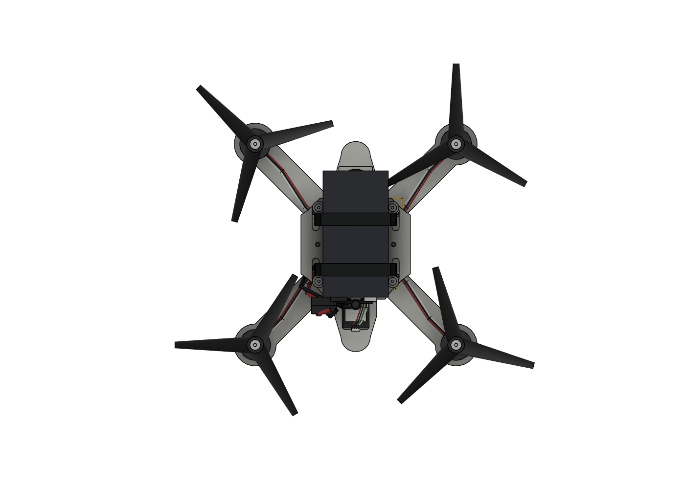

# 11 · Fusion 整机装配模型

> 2026-10-19：在 Fusion 的 `drone` 文档里把 **Kepler V** 机架补成整机装配。
> 原有底板、上层板和仿真墙都保留；仿真墙只隐藏，没有删除。

## 一、现在模型里有什么

装配根组件叫 `ASSEMBLY`，下面按零件分组。原来机架的两块板仍在根组件里，
名字改成了 `FRAME_BOTTOM_PLATE_4mm` / `FRAME_TOP_PLATE_3mm`，几何没有改。

| 组 | 内容 |
|---|---|
| 机架 | 底板 4.0 mm、上层板 3.0 mm、22 mm 净空 |
| 五金 | 4× M2×22 支撑柱、4× M2×5 尼龙柱、28× M2×6、4× M2×4、16× Ø4.5 平垫、8× Ø6 钢垫 |
| 动力 | 4× 1106 电机（含钟形罩散热槽、定子、1.5 mm 轴）、4× 3020-3 三叶桨、4× 桨螺母 |
| 飞控 | GHF435AIO V2 30×30×1.6，45° 摆放，含 MCU/陀螺/OSD/ELRS 屏蔽罩/气压计/黑匣子/电调 MOS/USB/焊盘/IPEX-1 |
| 导航 | PU-122Q GPS 12×16×7.2，含陶瓷天线、屏蔽罩、JST-SH 4P、备份电池 |
| 视频 | S1039 摄像头 10×10×11.7 + 22° 倾斜托架；TS5823 Pro 图传 30×20×8 + RP-SMA 天线 |
| 电源 | 3S 650 电池包络 60×31×22、两条 6 mm 电池扎带、XT30 公母、470 µF 电容、5 V 蜂鸣器 |
| 线束 | 4 组三相电机线、GPS 4 线、图传 5 线、相机 3 线、电池 2×18AWG、电容/蜂鸣器引线、天线馈线 |
| 其他 | 相机 2.5 mm 扎带、天线 TPU 支架、图传双面胶垫 |

## 二、关键尺寸（Fusion 实测）

| 项目 | 数值 |
|---|---|
| 电机中心 | (±47.73, ±47.73) mm |
| 轴距 | 135 mm |
| 机架最大外形 | 115.46 × 115.46 mm（不含桨） |
| 桨尖半径 | 38.13 mm（实测顶点，目标 38.1） |
| 桨盘直径 | 76.26 mm |
| 整机包络（含桨/天线） | Fusion AABB 约 184.6 × 197.1 × 65.8 mm；旋转桨的 AABB 偏保守，真实桨盘 Ø171.7 |
| 最低点 | 电机螺丝头 z = −5.8 mm |
| 最高点 | 图传天线顶 z = 60.0 mm |
| 底板 / 上层板 | 4.0 / 3.0 mm |
| 上下板净空 | 22.0 mm |
| 飞控板 | 30 × 30 × 1.6，安装孔 25.5 × 25.5 M2，旋转 45° |
| 飞控板中心高度 | z = 5.8 mm（底面 5.0，顶面 6.6） |
| 电机 | 底径 14.6，机身高 14.5，轴 1.5，4×M2 9×9 |
| 电池包络 | 60 × 31 × 22，底面 z = 25.51 |
| GPS | 12（X）× 16（Y）× 7.2，底面 z = −2.0；陶瓷片顶 z = 6.2 |
| 摄像头 | 10 × 10 × 11.7，倾角 22°，顶部约 z = 19.7 |
| 图传 | 30 × 20 × 8，z = 13.0…21.0，位于上层板下 |
| 电容 | Ø10 × 12.5，中心 (−10, −18.5) |
| 蜂鸣器 | Ø9 × 5.5，中心 (10, −19) |
| XT30 | 中心 (−15, −29, 30) |
| 图传天线 | 根部 (0, −28, 27)，鞭长约 30 mm |

## 三、五金数量核对

Fusion 里实际计数：

| 零件 | 数量 |
|---|---:|
| M2×6 | **28** |
| M2×4 | **4** |
| M2×22 支撑柱 | **4** |
| M2×5 尼龙柱 | **4** |
| Ø4.5 平垫 | **16**（电机螺丝） |
| Ø6 钢垫 | **8**（支撑柱上下各 4） |
| 1106 电机 | **4** |
| 3020-3 桨 | **4** |

螺丝长度按原文档分配：电机 16、支撑柱下 4、支撑柱上 4、飞控下 4、飞控上 4。
螺纹没有做螺旋几何，按光杆 + 通孔/间隙孔表示；螺丝头做了内六角沉孔。

## 四、干涉检查

用 Fusion 的 `check_interference` 对全部主要零件和线束做了检查。最后一次
结果里，大于 1 mm³ 的剩余重叠全部是**有意为之的连接件内部重叠**：

- XT30 插针与塑料壳；
- RP-SMA 螺母/螺纹套/弯头/鞭；
- 电容引线从电容顶部焊点出发；
- 天线馈线进入 RP-SMA 接头；
- 电源红/黑线在 XT30 附近并行（线-线，不是硬零件）。

初始版本发现并已修正的硬干涉：

- 电池扎带与 22 mm 支撑柱/顶部螺丝头；
- 相机托架与飞控前侧尼龙柱；
- 顶部 Ø6 垫片与电池底面；
- 飞控 ELRS 屏蔽罩与电调 MOS；
- 相机托架前唇与 S1039 镜头；
- 图传双面胶垫与天线支架。

> 说明：检查工具把插针/插壳、焊点/线材也当成实体，所以会报几十个体积很小的
> “连接件内部重叠”。这些不是装配碰撞；硬零件之间没有未处理的干涉。

## 五、必须说明的假设

1. **材料**：Fusion 材料库里没有 PLA，按你的要求先用 **ABS** 代替。
   机架和打印件都分配了 ABS 塑料，外观用了浅灰；这不会改变几何。
   原来的 PLA 仿真结果仍然按 PLA 1.24 g/cm³ 解释。
   > Fusion 的 mass properties 不要当整机称重：电池、飞控、图传、GPS 都是包络，
   > 材料也是近似分配。质量还是以实物称重为准。
2. **电池**：文档只给了 3S 650 mAh ≈60 g，没有给长宽高。模型用
   **60 × 31 × 22 mm** 的常见 3S 650 包络。换 850 mAh 或别的品牌必须重核
   扎带长度和上板空间。
3. **电池扎带**：模型用 **6 mm 宽**。10 mm 魔术贴会碰到 22 mm 支撑柱
   和顶部螺丝头；如果坚持 10 mm，需要把扎带从柱子外侧绕，或改槽位。
4. **相机托架**：原 `v3-camera-tray.stl` 的前唇会挡 S1039 镜头，而且
   托架与飞控前侧尼龙柱有干涉。Fusion 里改成了：
   - 去掉前唇，保留 22° 斜面；
   - 两侧加 1 mm 侧颊，夹住 10 mm 宽相机；
   - 后部开 5 mm 宽缺口，避开飞控尼龙柱；
   - 保留原来的 4 个 Ø2.6 扎带孔。
   新打印件是 `outputs/cad/v3r-camera-tray.stl`，旧 STL 不要再用。
5. **天线支架**：原机架没有天线孔。模型加了一个 TPU 夹子夹在上层板后缘，
   不切板；RP-SMA 座装在夹子外侧。新打印件是
   `outputs/cad/antenna-mount-tpu.stl`。
6. **图传固定**：裸板没有安装孔，用 0.3 mm 双面胶垫贴在上层板下面。
   模型里胶垫顶面 z = 21.3，电池扎带从它上方 0.0…0.3 mm 处经过；
   实机装配时先贴胶垫再穿扎带，确认不顶扎带。
7. **桨**：3020-3 的三叶用椭圆截面锥体做包络，不是精确翼型；桨尖半径
   38.13 mm，和 76.2 mm 直径一致。做气动/噪声分析不能直接用这个桨。
8. **摄像头/图传/飞控细节**：芯片、屏蔽罩、接插件、镜头都是按文档和参考图
   做的**包络**，不是厂家 STEP。安装孔和主要外形按官方尺寸。
9. **ELRS 2.4G 天线**：飞控板上保留了 IPEX-1 连接器包络，但没有建外置
   2.4G 天线，因为采购清单没有给天线型号/长度。买到实物后再补一段
   30 mm 左右的馈线 + T 天线即可。
10. **线束**：按实际路径做了柔性包络，长度是“能走到”的近似值，不是
    下线长度。电机线 0.8 mm、电源线 2 mm、信号线 0.6–0.7 mm。

## 六、新增打印件

| 文件 | 尺寸（mm） | 说明 |
|---|---|---|
| `outputs/cad/v3r-camera-tray.stl` | 16 × 17 × 12 | 已按打印坐标导出，底面 z=0，水密 |
| `outputs/cad/antenna-mount-tpu.stl` | 16 × 4 × 9 | 已按打印坐标导出，底面 z=0，水密 |

两个 STL 都用 trimesh 检查过 `is_watertight=True`。打印建议：

- 相机托架：PETG/ABS，0.2 mm 层高，4 圈壁，30–40% 填充；侧颊和斜面
  受力不大，重点是孔不要堵。
- 天线支架：TPU 或 PETG，2–3 圈壁；夹口靠弹性夹住上层板后缘。

## 七、还没做的事

- 没替你保存 Fusion 文档（按约定需要你按 Ctrl+S）。
- ELRS 2.4G 天线未建模（见假设 9）。
- OV2640 + DVR 录像模块未建模：文档只给了 3 g 和 `+ - AVI JPG` 焊盘定义，
  没有外形尺寸；如果确定安装位置，可以按 25×20×6 左右的包络补一个。
- 防反接 SS14、2N7002、1 kΩ 等小板件没有单独建模，它们通常直接焊在
  飞控/录像模块的线束上，不影响安装空间。
- 电池、图传胶垫、扎带的实际厚度/宽度要等实物到了再复核。
- `docs/03` 里提到的“上层板飞控孔没有用途”仍然成立；模型保留它们，
  没有拿来固定图传。

