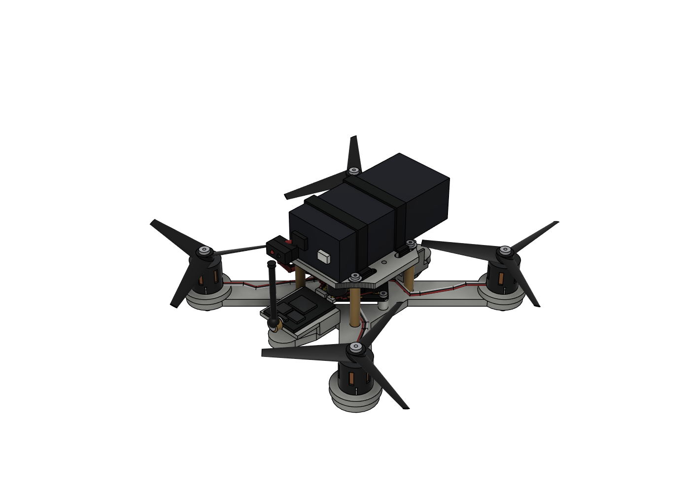
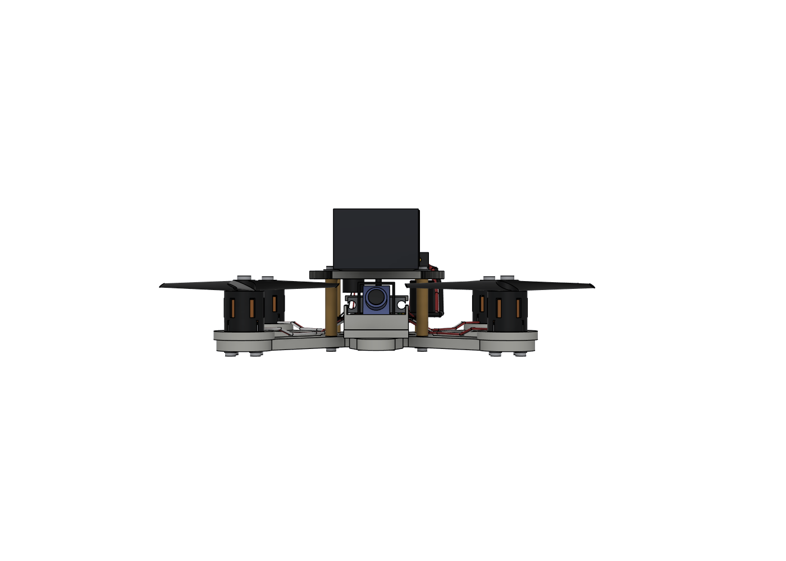
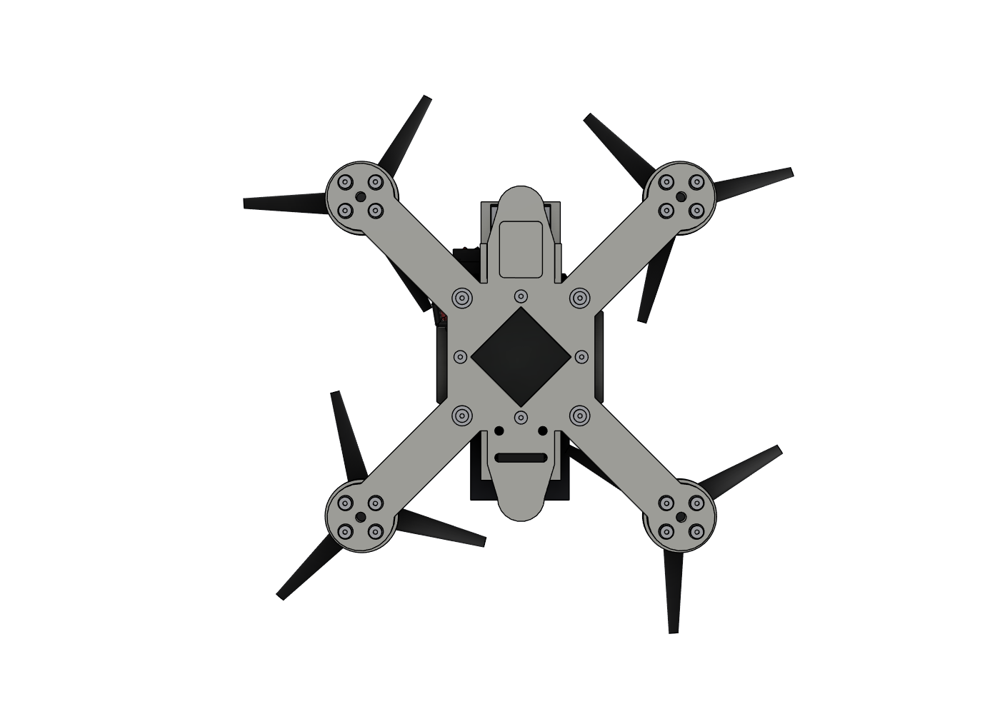
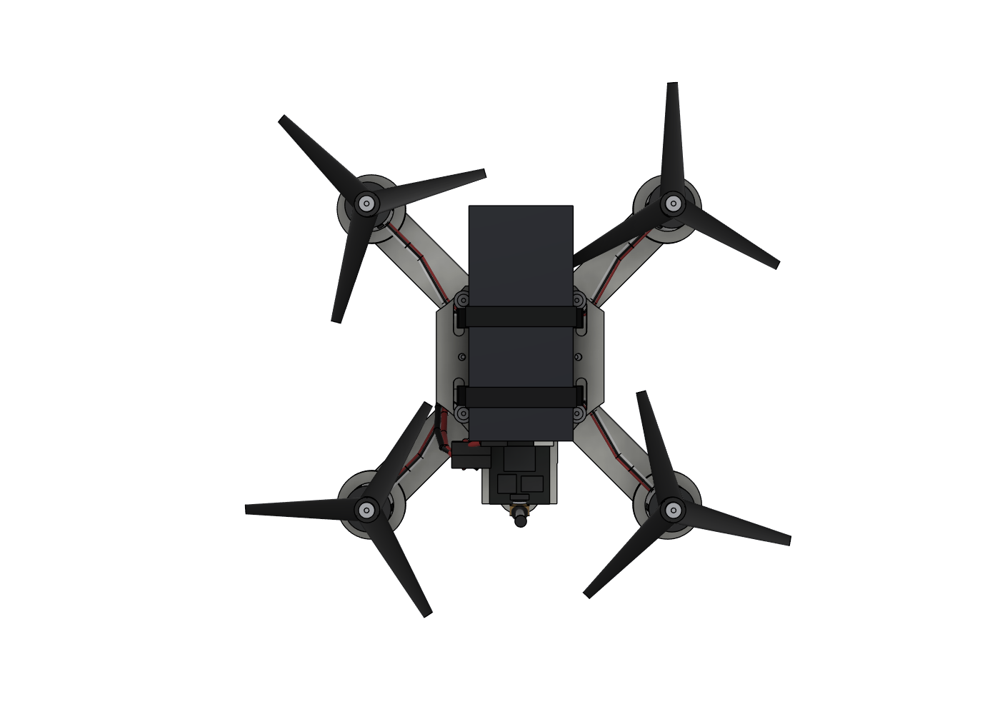

# 11 · Fusion 整机装配模型

> 2026-10-19：在 Fusion 的 `drone` 文档里把 **Kepler V** 机架补成整机装配。
> 原有底板、上层板和仿真墙都保留；仿真墙只隐藏，没有删除。

> **2026-10-22 实物修正（V4）**：电机孔位改成 **9 × 8.5 mm**，电机整体
> 抬高 **3 mm**；电池改成 **70 × 31 × 22 mm**；没有 GPS，尾部位置改放
> **19.2 × 25.1 mm 图传**；相机支架改成 **19 mm 双螺丝 + 长条孔**。
> 下面是 V3 的原始记录，V4 的具体尺寸和新增打印件见文末“V4 实物修正”。

> **2026-10-23 打印结构（V5）**：机架主打印件为 `PRINT_BASE`
> （底板 + VTX 托架安装孔）、`PRINT_TOP`（上层板）、独立的
> `MOTOR_SPACER_3MM` 电机垫片
> 和独立可编辑的 `VTX_TRAY_SEPARATE`。所有电机、飞控、电池、图传、相机等都在
> `VISUAL_ASSEMBLY` 里，只用于看装配关系，不参与打印。
> 电机安装定稿为 **4×Ø2.2 mm 圆通孔**，四个孔心组成**等边正方形**，
> 边长 **6.364 mm**，因此对角孔心距正好 **9.000 mm**；V4 里的
> `9 × 8.5`、长条孔和矩形孔心版本均已作废。

## 一、现在模型里有什么

装配根组件叫 `ASSEMBLY`，下面按零件分组。原来机架的两块板仍在根组件里，
名字改成了 `FRAME_BOTTOM_PLATE_4mm` / `FRAME_TOP_PLATE_3mm`，几何没有改。

| 组 | 内容 |
|---|---|
| 机架 | 底板 4.0 mm、上层板 3.0 mm、22 mm 净空 |
| 五金 | 4× M2×22 支撑柱、4× M2×5 尼龙柱、28× M2×6、4× M2×4、16× Ø4.5 平垫、8× Ø6 钢垫 |
| 动力 | 4× 1106 电机（含钟形罩散热槽、定子、1.5 mm 轴）、4× 3020-3 三叶桨、4× 桨螺母 |
| 飞控 | GHF435AIO V2 30×30×1.6，45° 摆放，含 MCU/陀螺/OSD/ELRS 屏蔽罩/气压计/黑匣子/电调 MOS/USB/焊盘/IPEX-1 |
| 导航 | PU-122Q GPS 12×16×7.2，含陶瓷天线、屏蔽罩、JST-SH 4P、备份电池 |
| 视频 | S1039 摄像头 10×10×11.7 + 22° 倾斜托架；TS5823 Pro 图传 30×20×8 + RP-SMA 天线 |
| 电源 | 3S 650 电池包络 60×31×22、两条 6 mm 电池扎带、XT30 公母、470 µF 电容、5 V 蜂鸣器 |
| 线束 | 4 组三相电机线、GPS 4 线、图传 5 线、相机 3 线、电池 2×18AWG、电容/蜂鸣器引线、天线馈线 |
| 其他 | 相机 2.5 mm 扎带、天线 TPU 支架、图传双面胶垫 |

## 二、关键尺寸（Fusion 实测）

| 项目 | 数值 |
|---|---|
| 电机中心 | (±47.73, ±47.73) mm |
| 轴距 | 135 mm |
| 机架最大外形 | 115.46 × 115.46 mm（不含桨） |
| 桨尖半径 | 38.13 mm（实测顶点，目标 38.1） |
| 桨盘直径 | 76.26 mm |
| 整机包络（含桨/天线） | Fusion AABB 约 184.6 × 197.1 × 65.8 mm；旋转桨的 AABB 偏保守，真实桨盘 Ø171.7 |
| 最低点 | 电机螺丝头 z = −5.8 mm |
| 最高点 | 图传天线顶 z = 60.0 mm |
| 底板 / 上层板 | 4.0 / 3.0 mm |
| 上下板净空 | **26.5 mm**（22 mm 支撑柱 + 4.5 mm spacer） |
| 飞控板 | 30 × 30 × 1.6，安装孔 25.5 × 25.5 M2，旋转 45° |
| 飞控板中心高度 | z = 5.8 mm（底面 5.0，顶面 6.6） |
| 电机 | 底径 14.6，机身高 14.5，轴 1.5，4×M2 9×9 |
| 电池包络 | **70 × 31 × 22，底面 z = 30.01**（随顶层一起抬高 4.5 mm） |
| GPS | 12（X）× 16（Y）× 7.2，底面 z = −2.0；陶瓷片顶 z = 6.2 |
| 摄像头 | 10 × 10 × 11.7，倾角 22°，顶部约 z = 19.7 |
| 图传 | 30 × 20 × 8，z = 13.0…21.0，位于上层板下 |
| 电容 | Ø10 × 12.5，中心 (−10, −18.5) |
| 蜂鸣器 | Ø9 × 5.5，中心 (10, −19) |
| XT30 | 中心 (−15, −29, 30) |
| 图传天线 | 根部 (0, −28, 27)，鞭长约 30 mm |

## 三、五金数量核对

Fusion 里实际计数：

| 零件 | 数量 |
|---|---:|
| M2×6 | **28** |
| M2×4 | **4** |
| M2×22 支撑柱 | **4** |
| M2×5 尼龙柱 | **4** |
| Ø4.5 平垫 | **16**（电机螺丝） |
| Ø6 钢垫 | **8**（支撑柱上下各 4） |
| 1106 电机 | **4** |
| 3020-3 桨 | **4** |

螺丝长度按原文档分配：电机 16、支撑柱下 4、支撑柱上 4、飞控下 4、飞控上 4。
螺纹没有做螺旋几何，按光杆 + 通孔/间隙孔表示；螺丝头做了内六角沉孔。

## 四、干涉检查

用 Fusion 的 `check_interference` 对全部主要零件和线束做了检查。最后一次
结果里，大于 1 mm³ 的剩余重叠全部是**有意为之的连接件内部重叠**：

- XT30 插针与塑料壳；
- RP-SMA 螺母/螺纹套/弯头/鞭；
- 电容引线从电容顶部焊点出发；
- 天线馈线进入 RP-SMA 接头；
- 电源红/黑线在 XT30 附近并行（线-线，不是硬零件）。

初始版本发现并已修正的硬干涉：

- 电池扎带与 22 mm 支撑柱/顶部螺丝头；
- 相机托架与飞控前侧尼龙柱；
- 顶部 Ø6 垫片与电池底面；
- 飞控 ELRS 屏蔽罩与电调 MOS；
- 相机托架前唇与 S1039 镜头；
- 图传双面胶垫与天线支架。

> 说明：检查工具把插针/插壳、焊点/线材也当成实体，所以会报几十个体积很小的
> “连接件内部重叠”。这些不是装配碰撞；硬零件之间没有未处理的干涉。

## 五、必须说明的假设

1. **材料**：Fusion 材料库里没有 PLA，按你的要求先用 **ABS** 代替。
   机架和打印件都分配了 ABS 塑料，外观用了浅灰；这不会改变几何。
   原来的 PLA 仿真结果仍然按 PLA 1.24 g/cm³ 解释。
   > Fusion 的 mass properties 不要当整机称重：电池、飞控、图传、GPS 都是包络，
   > 材料也是近似分配。质量还是以实物称重为准。
2. **电池**：文档只给了 3S 650 mAh ≈60 g，没有给长宽高。模型用
   **60 × 31 × 22 mm** 的常见 3S 650 包络。换 850 mAh 或别的品牌必须重核
   扎带长度和上板空间。
3. **电池扎带**：模型用 **6 mm 宽**。10 mm 魔术贴会碰到 22 mm 支撑柱
   和顶部螺丝头；如果坚持 10 mm，需要把扎带从柱子外侧绕，或改槽位。
4. **相机托架**：原 `v3-camera-tray.stl` 的前唇会挡 S1039 镜头，而且
   托架与飞控前侧尼龙柱有干涉。Fusion 里改成了：
   - 去掉前唇，保留 22° 斜面；
   - 两侧加 1 mm 侧颊，夹住 10 mm 宽相机；
   - 后部开 5 mm 宽缺口，避开飞控尼龙柱；
   - 保留原来的 4 个 Ø2.6 扎带孔。
   旧版相机托架见 `outputs/cad/previous-versions/v3/v3r-camera-tray.stl`。
5. **天线支架**：原机架没有天线孔。模型加了一个 TPU 夹子夹在上层板后缘，
   不切板；RP-SMA 座装在夹子外侧。新打印件是
   `outputs/cad/previous-versions/v3/antenna-mount-tpu.stl`。
6. **图传固定**：裸板没有安装孔，用 0.3 mm 双面胶垫贴在上层板下面。
   模型里胶垫顶面 z = 21.3，电池扎带从它上方 0.0…0.3 mm 处经过；
   实机装配时先贴胶垫再穿扎带，确认不顶扎带。
7. **桨**：3020-3 的三叶用椭圆截面锥体做包络，不是精确翼型；桨尖半径
   38.13 mm，和 76.2 mm 直径一致。做气动/噪声分析不能直接用这个桨。
8. **摄像头/图传/飞控细节**：芯片、屏蔽罩、接插件、镜头都是按文档和参考图
   做的**包络**，不是厂家 STEP。安装孔和主要外形按官方尺寸。
9. **ELRS 2.4G 天线**：飞控板上保留了 IPEX-1 连接器包络，但没有建外置
   2.4G 天线，因为采购清单没有给天线型号/长度。买到实物后再补一段
   30 mm 左右的馈线 + T 天线即可。
10. **线束**：按实际路径做了柔性包络，长度是“能走到”的近似值，不是
    下线长度。电机线 0.8 mm、电源线 2 mm、信号线 0.6–0.7 mm。

## 六、新增打印件

| 文件 | 尺寸（mm） | 说明 |
|---|---|---|
| `outputs/cad/previous-versions/v3/v3r-camera-tray.stl` | 16 × 17 × 12 | 历史件 |
| `outputs/cad/previous-versions/v3/antenna-mount-tpu.stl` | 16 × 4 × 9 | 历史件 |

两个 STL 都用 trimesh 检查过 `is_watertight=True`。打印建议：

- 相机托架：PETG/ABS，0.2 mm 层高，4 圈壁，30–40% 填充；侧颊和斜面
  受力不大，重点是孔不要堵。
- 天线支架：TPU 或 PETG，2–3 圈壁；夹口靠弹性夹住上层板后缘。

## 七、还没做的事

- 没替你保存 Fusion 文档（按约定需要你按 Ctrl+S）。
- ELRS 2.4G 天线未建模（见假设 9）。
- OV2640 + DVR 录像模块未建模：文档只给了 3 g 和 `+ - AVI JPG` 焊盘定义，
  没有外形尺寸；如果确定安装位置，可以按 25×20×6 左右的包络补一个。
- 防反接 SS14、2N7002、1 kΩ 等小板件没有单独建模，它们通常直接焊在
  飞控/录像模块的线束上，不影响安装空间。
- 电池、图传胶垫、扎带的实际厚度/宽度要等实物到了再复核。
- `docs/03` 里提到的“上层板飞控孔没有用途”仍然成立；模型保留它们，
  没有拿来固定图传。

---

## 八、V4 实物修正（2026-10-22）

这一版是拿实物尺寸改的，优先按“能装”而不是按旧文档。

### 电机与五金

| 项目 | V4 |
|---|---|
| 电机安装孔 | **9.0 × 8.5 mm**（孔中心，X × Y） |
| 电机外径 | **14.5 mm** |
| 电机抬高 | **3.0 mm**（新增 Ø22 × 3 垫块，中心 Ø8 过线） |
| 电机螺丝 | **M2×10 + 0.5 mm 平垫**，进入电机约 2.5 mm |
| 电机总高 | 机体 z = 3.0…17.5，轴到 z = 23.0 |
| 桨 | z = 17.5…21.5，桨螺母 z = 21.5…23.0 |

底板 16 个电机孔已在原参数草图里从 9×9 改成 **9×8.5**，不是只改电机包络。
桨叶靠近上层板的位置最高约 **z = 20.2**，上层板底面 z = 22.01，净空约
**1.8 mm**；桨毂/螺母在电机中心，不在上层板正下方。这个 1.8 mm 是抬 3 mm
后的代价，实机第一次转桨前要确认桨叶不会扫到上板。

螺丝数量相应变成：

| 螺丝 | 数量 | 用途 |
|---|---:|---|
| M2×10 | **16** | 电机 |
| M2×6 | **12** | 支撑柱上下 8 + 飞控下 4 |
| M2×4 | **4** | 飞控上 |

原来的 M2×6 套装里会剩不少；M2×10 目前模型要 16 颗，如果实物只有 10 颗，
需要再补 6 颗。

### 电池

- 实际包络：**70 × 31 × 22 mm**。
- 中心放在 y = **10 mm**，即 y = −25…45，比旧 60 mm 电池更靠前，兼顾重心。
- 电池扎带仍是 6 mm 宽，位置 y = ±12；70 mm 电池仍在两条扎带范围内。
- XT30 在电池尾部，公母对插放在 **(−15, −30, 30)**。

### 图传 / GPS 位置

- **没有 GPS**，原 GPS 位置改放图传。
- 图传板：**19.2 × 25.1 mm**，屏蔽盖 **17.8 × 22 mm**。
- 图传平放，屏蔽盖朝下，天线座朝后；PCB 的尾部 y = **−47**，天线座正好在
  VTX 安装板后缘。
- 新增 `VTX_MOUNT_V3` 打印支架：
  - 外形约 **24.4 × 25.5 × 7 mm**；
  - 中间 18.2 × 23.4 mm 的镂空让 17.8 × 22 mm 屏蔽盖“卡进去”；
  - 板面 z = 5…7，VTX 板 z = 7…8.6，屏蔽盖 z = 4…7；
  - 前端两片侧壁夹住 20 mm 宽尾段，后部悬挑承托 VTX。
- 屏蔽盖的镂空做在 **VTX 安装板**上，不在底板本体上直接挖；这样不破坏
  尾部承力结构。如果你要底板本体带这个坑，需要再改底板。
- RP-SMA 直接装在 VTX 后缘，天线从 y ≈ −49、z ≈ 7.8 起，鞭顶 z ≈ 40.8。

> 屏蔽盖高度按 **3 mm** 建模；如果实物屏蔽盖高于 5 mm，需要把安装板再抬高。

> **最终方向（V5 后续）**：图传恢复**屏蔽盖朝下**；屏蔽盖下方加鳍片，
> 鳍片下面放侧吹涡扇，风从鳍片抽出后朝 FC 方向吹。上面的“朝上”版本已作废。

电容和蜂鸣器也顺势挪开尾部：电容在 **(−18, −4, 8.5)**、蜂鸣器在
**(10, −21, 16.5)**，都在上层板下方，避免和图传安装板打架。

### 相机支架

- 相机支架两螺丝孔距按 **19 mm** 做。
- 托架加宽到 24 mm，后法兰做两个 **6 × 3.2 mm 长条孔**，左右各允许约 ±3 mm
  误差。
- 新增 `CAMERA_BRACKET_V4` 包络：22 mm 宽、两孔中心距 19 mm，和托架长条孔对齐。
- 托架外形约 **24 × 18 × 15.5 mm**，相机仍保持 22° 倾斜。

### V4 新增/更新打印件

| 文件 | 尺寸（mm） | 用途 |
|---|---|---|
| `outputs/cad/previous-versions/v4/v4-bottom-plate-motor9x8.5.stl` | 115.46 × 115.46 × 4.0 | 历史底板 |
| `outputs/cad/previous-versions/v4/motor-riser-3mm.stl` | Ø22 × 3.0 | 历史电机垫块 |
| `outputs/cad/previous-versions/v4/v4-camera-tray.stl` | 24 × 18 × 15.5 | 历史相机托架 |
| `outputs/cad/previous-versions/v4/camera-bracket-19mm.stl` | 22 × 2.5 × 6.0 | 历史相机支架 |
| `outputs/cad/previous-versions/v4/vtx-mount-19.2x25.1.stl` | 24.4 × 25.5 × 7.0 | 历史图传安装板 |

全部 STL 都用 trimesh 检查过 `is_watertight=True`。

### V4 干涉结果

最后一轮检查里，剩下的 >1 mm³ 重叠只有：

- 相机支架故意夹住相机；
- XT30 插针/塑料壳、RP-SMA 螺母/弯头/鞭；
- 电容引线从电容顶部焊出；
- 电源红/黑线在 XT30 附近并行。

机架、电机、电机垫块、螺丝、电池、尾部图传安装板、相机托架之间没有未处理的
硬干涉。

### V4 还需要确认

- 图传屏蔽盖实际高度（现在按 3 mm、安装板下方留 4 mm 空间）。
- 相机支架螺丝是 M2 还是 M3（长条孔按 M3 的 3.2 mm 宽做，M2 也能用）。
- M2×10 是否够 16 颗。
- 70 mm 电池在 y = 10 的位置是否和你实际的重心一致；如果要更靠前/后，
  整块电池和 XT30 可以一起平移。

---

## 九、V5 打印对象拆分（2026-10-23 更新）

Fusion 浏览器现在按“打印”和“视觉”分开：

| 浏览器对象 | 内容 | 是否打印 |
|---|---|---|
| `PRINT_BASE` | 底板 + **VTX 托架安装座**，一个实体；电机孔仍为 4×M2、孔心对角 9.000 mm，电机 3 mm 垫片改为独立件 | **是** |
| `PRINT_TOP` | 上层板，一个实体 | **是** |
| `TOP_LAYER_SPACER` | 4.5 mm 厚 U 形抬高层，四个原支撑柱孔位，前部开口避让相机 uptilt | **是** |
| `MOTOR_SPACER_3MM` | Ø18 × 3 mm 单块电机垫片，四个 Ø2.2 孔，一侧开 4.4 mm 走线槽；视觉装配中也放有 4 片 | **是** |
| `XT30_CLAMP_BASE` | 挂在顶层后孔下方的固定 C 形件，含两个 3.9 mm 六角螺母槽 | **是** |
| `XT30_CLAMP_PLATE` | 外侧可拆压板，两颗水平 M2 螺丝从外侧压紧 XT30 线 | **是** |
| `VTX_TRAY_SEPARATE` | 独立 VTX 托架，上下两层框 + 4 根立柱 + 后部斜撑，四颗 M2 安装 | **是** |
| `VISUAL_ASSEMBLY` | 电机、桨、飞控、电池、图传、相机、20×20 风扇、线束等 | 否，只看装配 |

- `PRINT_BASE` 和 `VTX_TRAY_SEPARATE` 各是一个水密实体；旧的一体式 VTX 支撑
  已经从底座中移除，避免支架过薄、悬空过长且不好修改。
- 底座上的 16 个固定小柱已移除，电机由独立 **MOTOR_SPACER_3MM**
  垫高 3 mm；四个孔的孔心仍为 **边长 6.364 mm 的等边正方形**，
  对角孔心距 **9.000 mm**，一侧留 **4.4 mm** 走线槽。
- VTX 恢复 **屏蔽盖朝下**：保护壳厚 **1.8**，板 z = 14.7…16.3，
  屏蔽盖 z = 12.9…14.7。
- 屏蔽盖下加 17.8 × 22 鳍片，总高 **4.6**，鳍片 z = 8.3…12.9。
- 风扇仍为 **20 × 20 × 6**，包络 z = 2…8；独立托架的下框在 z = 0.8…2.0，
  中心开 20.4 × 20.4 mm 风扇孔，顶部与风扇底面留接触面。
  风扇顶面 z = 8，鳍片底 z = 8.3，**留 0.3 mm 气隙**，尽量贴但不碰。
  涡扇平放，侧出风朝 **+Y（FC 方向）**，从鳍片区域抽风后吹向 FC；风扇是视觉件。
- `VTX_TRAY_SEPARATE` 的上框在 z = 12.8…14.7，厚 **1.9 mm**；
  四周为实体框，中间开槽容纳 17.8 × 22 mm 屏蔽盖，并在尾部留出 RP-SMA 缺口。
- 托架有四根立柱：前柱在 x=±10.8、y≈−23；后柱在 x=±10.8、y≈−46.5；
  后安装点收进尾板到 x=±5、y=−42，通过两根斜撑把载荷传到后柱。
- `PRINT_BASE` 的模型 z = −4…0.8；导出的打印 STL 是 z = 0…4.8。
- `TOP_LAYER_SPACER` 的模型 z = 22…26.5，厚度 **4.5 mm**；
  外形为 U 形框，前部中央开口给摄像头 uptilt 让位，两侧开电池扎带通过槽；
  后部的 `(0, -18.031)` 孔与 `PRINT_TOP` 对齐，供 XT30 线夹固定。
- 电机垫片 `MOTOR_SPACER_3MM` 为 **Ø18 × 3 mm** 单块圆盘；四个螺钉孔按
  边长 6.364 mm 的正方形布置，对角 **9 mm**，相邻孔之间一侧开
  **4.4 mm** 走线槽。另一个备用件放在机身右侧 x=76…94 mm 的工作区。
- `XT30_CLAMP_BASE` 通过顶层后部 `(0, -18.031)` 的单颗 M2 固定；
  固定 C 件内置两个 **3.9 mm 六角螺母槽**，外侧的 `XT30_CLAMP_PLATE`
  通过两颗 M2 前后夹紧 XT30 线。
- `PRINT_TOP` 的模型 z = 26.51…29.51；导出的打印 STL 是 z = 0…3。
  当前相机最高点约 z = 20.49，上层板底面与相机静态包络的净空约 **6.0 mm**。
- `PRINT_BASE` 中央菱形镂空的标称半对角由 **16 mm 扩大到 18 mm**，
  即轴向理论宽度从 **32 mm 增到 36 mm**；与周围已有孔位贯通后，
  实际开口轴向边界约为 **±20 mm**。
- `PRINT_BASE` 前端两对相机安装孔改为 **x=±10.0 mm**，
  即每排孔距 **20 mm**，两排 y 坐标仍为 22 / 30 mm；前端两侧加宽到
  x=±12.3 mm，保证孔边余量。
  原有 `CAMERA_TRAY_V4` / `CAMERA_BRACKET_V4` 保持 19 mm 孔距不变。
- 图传由独立托架的上框托住，屏蔽盖朝下，天线座仍在后缘。
- `VISUAL_ASSEMBLY` 里的相机托架/支架仍然是另外的打印件，不属于机架两层；
  如果你要把它们也并进 base，需要再改。

### V5 打印文件

| 文件 | 尺寸（mm） | 水密 |
|---|---|---|
| `outputs/cad/v5-base-print.stl` | 117.44 × 117.44 × 4.8 | 是 |
| `outputs/cad/v5-top-print.stl` | 52 × 48 × 3.0 | 是 |
| `outputs/cad/v5-top-layer-spacer-4.5.stl` | 42 × 41 × 4.5 | 是 |
| `outputs/cad/motor-spacer-3mm-four-hole-slot.stl` | Ø18 × 3.0 | 是 |
| `outputs/cad/xt30-cable-clamp-base.stl` | 20 × 12.5 × 5.2 | 是 |
| `outputs/cad/xt30-cable-clamp-plate.stl` | 20 × 2 × 3.8 | 是 |
| `outputs/cad/v5-vtx-tray-separate.stl` | 28.0 × 29.2 × 13.9 | 是 |

V4 里的 `v4-bottom-plate-motor9x8.5.stl`、`motor-riser-3mm.stl`、
`vtx-mount-19.2x25.1.stl` 现在只作历史对照，**不要分开打印**。
