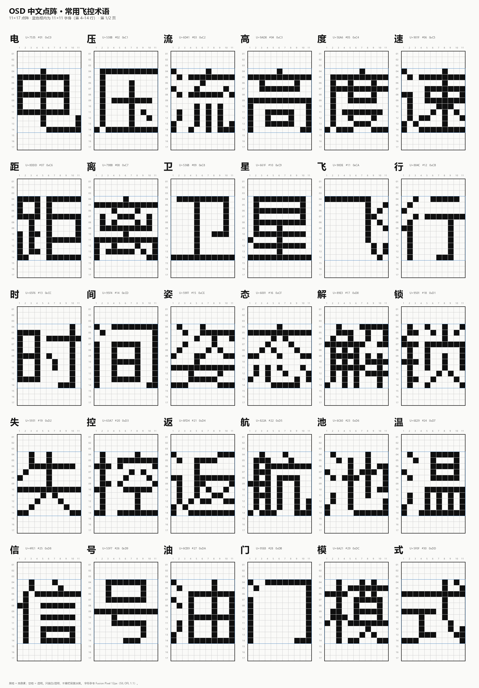

# 12 · OSD 中文点阵与 .mcm 字库（11×17）

飞控上的 **AT7456E** 是 MAX7456 兼容 OSD：每个字符在芯片里是 **12×18** 像素，
实际手画时常用的可画区是 **11×17**。汉字可以塞进这个格子，但一个汉字只能占一个字符槽，
而整颗芯片只有 **256 个槽**（ASCII 字母、数字和 OSD 图标还要占掉一部分）。

程序会同时输出**照着画的点阵参考图**和 **MAX7456 `.mcm` 字库**。点阵图可以在
Betaflight 的 OSD 字体编辑器、MAX7456 Font Editor，或任何 12×18 点阵工具里手动填；
`.mcm` 可以直接在 Betaflight Configurator 的字体管理器里加载。



## 怎么画

- 图里的 **黑格 = 亮像素（值 2）**。
- **空格 = 透明（值 1）**，不是黑色背景。
- 不要用值 0 的黑色像素；在视频叠加时它会变成一块不透明的黑框。
- 字身是 **11×11**，放在第 **4–14 行**；第 1–3 行和第 15–17 行留白。
- 图上有列号 1–11、行号 1–17；蓝色框就是 11×11 字身范围。
- 每个汉字占 1 个 OSD 字符格；一行最多 30 格（PAL）。

## 输入中文生成新图

项目虚拟环境里已经装了 Pillow。命令：

```powershell
.venv\Scripts\python.exe tools\osd_cn_dotmatrix.py --text "电压电流高度速度距离卫星" --out-dir outputs\osd_font
```

也可以把字放进 UTF-8 文本文件：

```powershell
.venv\Scripts\python.exe tools\osd_cn_dotmatrix.py --text-file chars.txt
```

默认会：

1. 去掉空格和重复字；
2. 跳过 ASCII 字符（原有 OSD 字库已经有数字和英文字母，不浪费槽位）；
3. 每个汉字生成 17 行 × 11 列的点阵；
4. 输出分页 PNG、SVG、空白模板、CSV/JSON/TXT 点阵数据和 OSD 效果预览；
5. 把汉字写进 MAX7456 `.mcm`，同时输出 `osd_cn.h` 和字符映射表。

如果想连 ASCII 一起生成，加 `--include-ascii`。

## 字库没有的字

程序会先查内置的 12px 像素字库。查不到时，会尝试用系统中文字体（微软雅黑、Noto、黑体等）
渲染成 11×11 点阵兜底，并在 CSV/JSON 的 `source` 列标成 `fallback`，同时在输出 README 里提示。

如果系统字体也没有这个字，程序会明确报“缺字”，不会静默输出一个方框。
注意：11×11 对笔画很多的生僻字本来就很小，兜底结果可能比较挤。

## .mcm 字库

`.mcm` 使用 Betaflight 默认字库作底，ASCII、数字和 OSD 图标保持原样，只替换汉字占用的槽。

图形界面默认使用“只填空隙”；命令行默认是 `compact` 模式：

- 从 `0xC0` 开始连续写；
- 最多 64 个汉字（`0xC0–0xFF`）；
- 保留 `0x80–0xBF` 的电池、姿态、方向、速度单位等关键图标；
- 会覆盖 `0xC0` 以上的 Logo/装饰槽，具体覆盖了哪些槽会写在 `README.md` 和 `osd_cn_map.csv` 里。

如果想在命令行也只填空隙，用 `gaps`（`safe` 是别名）模式：

```powershell
python tools\osd_cn_dotmatrix.py --text "电压电流" --mcm-mode gaps
```

`gaps` 只写所选底字库里的空槽；字数超过空槽数就会明确提示放不下。

其他参数：

```powershell
--mcm-start 0xC0     # compact 模式起始槽
--no-mcm             # 只出点阵图
--base-mcm 路径      # 换底字库
```

## 手动选底字库槽位

图形界面里可以：

1. 在“底字库（.mcm）”里选择自己的字库；
2. 输入要生成的汉字；
3. 点“手动分配…”打开 16×16 槽位表；
4. 左边点一个汉字，再点右边一个格子；
5. 绿色格子是底字库空槽，橙色点表示这个格子已有字符、会被替换；
6. 点“自动填空隙”可以先把未分配的字塞进空槽，再手动改想替换的格子；
7. 点“保存映射并返回”，然后生成点阵图和 `.mcm`。

右键可以清除某个格子的分配。保存映射后，生成时会优先使用这份手动映射；
如果后来改了文字导致映射不完整，程序会提示你补分配。

## 输出文件

默认在 `outputs/osd_font/`：

| 文件 | 用途 |
|---|---|
| `dotmatrix_page_01.png`、`02.png` | 直接照着画的分页总表 |
| `dotmatrix_all.svg` | 矢量版，放大不糊 |
| `blank_11x17.png` / `.svg` | 空白练习模板 |
| `preview_osd.png` | 模拟 OSD 显示效果 |
| `glyphs.csv` | 每行 17 个 0/1 串，方便脚本处理 |
| `glyphs.txt` | 纯文本点阵，适合复制粘贴 |
| `glyphs.json` | 带字符、Unicode、建议槽位的结构化数据 |
| `osd_cn.mcm` | MAX7456 字库，Betaflight 字体管理器可加载 |
| `osd_cn.h` | 16 KB 打包 C 头文件，给自定义固件用 |
| `osd_cn_map.csv` | 汉字 ↔ 字符槽映射 |

## 槽位怎么选

MAX7456 只有 256 个字符码：

- `0x20–0x7E`：ASCII 字母、数字、标点，建议保留。
- `0x00–0x1F`、`0x80–0x9F`：Betaflight 的方向、电池、姿态条等图标。
- `0xA0–0xFF`：Logo 和其他符号。

所以没有一整段“完全空着”的槽位。图上的 `#01–#NN` 是顺序编号，
`glyphs.csv/json` 里的 `suggested_code` 是实际写入 `.mcm` 的字符码。
默认 `0xC0` 起会保留电池/姿态等关键图标，但会替换 Logo/装饰槽；
想全部保留图标就用 `--mcm-mode safe`。

## 一个必须知道的限制

换字库只改变“某个字符码长什么样”，不会自动把 Betaflight 固件里写死的英文标签
变成中文。`VOLT`、`BAT`、`ALT` 这些标签是固件里的 ASCII 字符串；要显示中文，
需要有自定义字符码的输出方式，或者改固件/使用支持自定义文本的 OSD 方案。
这份工具解决的是“汉字在 11×17 里怎么画、怎么打进字库”这一步。

## 字形来源

默认字形来自 `assets/fonts/fusion-pixel-12px-monospaced-zh_hans.ms.bitmap.ttf`
（Fusion Pixel 12px，SIL Open Font License 1.1，许可证见同目录 `OFL.txt`）。
它本身就是 12px 中文像素字体，9–11px 的笔画比把微软雅黑直接缩小清楚得多。
如果你想换字形，可以用 `--font` 指定别的像素字体，并配合 `--font-size`。

`.mcm` 底字库来自 Betaflight Configurator 的
`resources/osd/1/betaflight.mcm`，仅用于保留 ASCII 和 OSD 图标；来源与许可证说明见
`assets/fonts/BETAFLIGHT_BASE_NOTICE.txt`。
