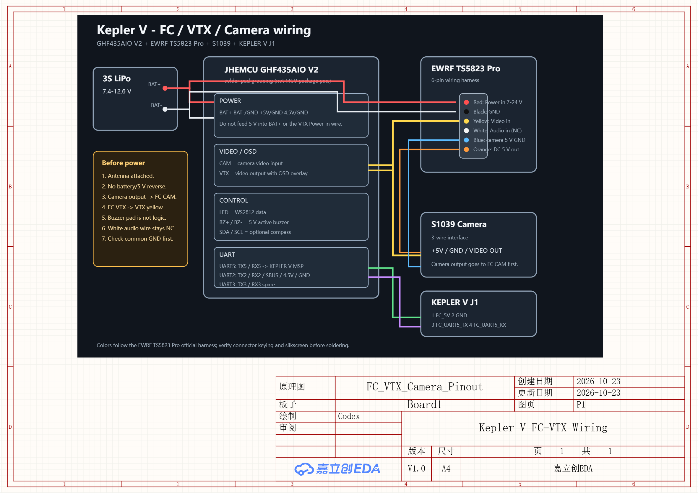

# 15 · FC 与图传接线速查

> 适用机型：Kepler V / JHEMCU GHF435AIO V2 / EWRF TS5823 Pro 600 mW /
> S1039 camera / KEPLER V 辅助控制模块。
>
> 本页只定义飞控的**外露焊盘和功能**，不把 MCU 内部 GPIO 名称当成板上焊盘名。
> 焊线前以实物丝印和万用表复核为准。



矢量源：[fc-vtx-wiring.svg](../assets/images/fc-vtx-wiring.svg)

## 一、先把焊盘认清

### 电源、视频、控制

| 飞控焊盘 | 方向 / 电平 | 接到哪里 | 说明 |
|---|---|---|---|
| `BAT+` | 电池正极输入/输出，7.4-16.8 V | 电池正极、图传 `Power in` | 与当前电池电压相同，不是 5 V |
| `BAT-` / `GND` | 0 V | 电池负极、所有模块地 | 必须共地 |
| `+5V` / `5V` | 5 V BEC 输出，额定 2.5 A | KEPLER V `FC_5V`、摄像头可选供电 | 先量电压，不要反灌 |
| `4.5V` | 接收机供电输出 | 外置接收机 `+4.5V` | 只在用外置接收机时使用 |
| `CAM` | 视频输入 | 摄像头 `VIDEO OUT` | 接到飞控 OSD，不要把摄像头直接接图传 |
| `VTX` | 带 OSD 的视频输出 | 图传黄色 `Video-in` | 这是视频信号，不是图传电源 |
| `BZ+` | 蜂鸣器正端/开关端 | 5 V 有源蜂鸣器正端 | 不要把蜂鸣器焊盘当逻辑输入 |
| `BZ-` | 蜂鸣器负端/开关回路 | 蜂鸣器负端 | 与蜂鸣器规格一起核对 |
| `LED` | WS2812 数据 | 灯带 `DIN` | 灯带另接 `+5V` 和 `GND` |

### 串口和 I2C

| 飞控端口 | 板上焊盘 | 本项目用途 | 备注 |
|---|---|---|---|
| UART1 | `TX1` / `RX1` | 板载 ELRS 相关 | 官方接线图标注内置 ELRS 使用 UART1；以 Betaflight `resource` 实读为准 |
| UART2 | `TX2` / `RX2` / `SBUS` / `4.5V` / `GND` | 外置接收机或 GPS 备选 | 与 UART1 的接收机分配不要同时占用 |
| UART3 | `TX3` / `RX3` | 预留 | 第一版不接录像模块 UART |
| UART5 | `TX5` / `RX5` | KEPLER V MSP | 115200，UART5 设为 MSP |
| I2C | `SDA` / `SCL` | 预留罗盘 | 未买 GPS；以后扩展时再用 |

> UART 分配有一处资料冲突：官方接线图写“内置 ELRS 打开 UART1”，但项目旧文档
> 写“板载 ELRS 占用 UART2”。实际装机先连接 Betaflight，在 CLI 执行 `resource`，
> 按真实资源表确认后再给 GPS/外置接收机定口。

### 接收机烧录、USB 和调试焊盘

| 板上丝印/焊盘 | 用途 | 接线注意 |
|---|---|---|
| `3.3V` / `GND` / `TX` / `RX` | 板载 ELRS 一侧的烧录/调试 UART 小焊盘 | 3.3 V 逻辑，不能接 5 V；不要把它当空闲飞控串口直接接外设 |
| `ELRS-BOOT` | ELRS 烧录/Boot 焊盘 | 只在刷接收机固件时按短接/按键要求使用 |
| `FC-BOOT` | 飞控 DFU/Boot | 正常上电不要短接；刷写时按 AT32 DFU 流程操作 |
| `VUSB` / `D+` / `D-` / `GND` | Micro USB 的扩展焊盘 | 只在需要外接 USB 座时使用；D+/D- 不要反接 |
| `BAT` / `GND` / `R` 附近小焊盘 | 板载电流/电压检测相关测试点 | 不要拿这里充当额外电源输出；具体定义以实物丝印和原厂图为准 |

### 电机和电源功率焊盘

| 焊盘组 | 功能 |
|---|---|
| `MOTOR1` / `MOTOR2` / `MOTOR3` / `MOTOR4`，每组 3 个焊盘 | 四路三相电机输出，顺序按 Betaflight resource 映射 |
| 底部 `BAT GND` | 主电池输入 |
| 底部 3 个大焊盘，旁边标 `13A / 20A` | 板载 20 A 四合一电调功率区；接线前按热风/烙铁能力处理 |
| `CURRENT` / `R` 相关小焊盘 | 板载电流/电压检测相关，当前不外加分流器 |
| `FC-BOOT` | DFU/BOOT 按键或焊盘，正常装机不要短路 |

## 二、TS5823 Pro 图传 6 芯口

官方手册定义的 6 根线如下。**颜色是原厂线序提示，不应只看颜色猜极性，必须先核对插头防呆和实物丝印。**

| 线色 | 图传引脚 | 方向 | Kepler V 接法 |
|---|---|---|---|
| 红 | `Power in` | 电源输入 DC 7-24 V | 接飞控 `BAT+` / 电池正极 |
| 黑 | `GND` | 功率地 | 接飞控 `GND` / 电池负极 |
| 黄 | `Video in` | 视频输入 | 接飞控 `VTX` |
| 白 | `Audio in` | 音频输入 | 本机不用，单独绝缘 |
| 蓝 | `GND` | 摄像头 5 V 回路地 | 接摄像头 `GND` |
| 橙 | `DC 5V out` | 摄像头供电输出 | 接 S1039 `+5V` |

注意：

- 红灯线绝对不能接飞控 `+5V`；它需要 7-24 V，直接接电池电压。
- 图传蓝色地是 5 V 输出侧地，实际仍与主 `GND` 共地，但建议按原厂线束分别走到摄像头。
- 白色音频输入不用时单独包好，不要和 `BAT+` 或视频信号碰在一起。
- 第一次上电前天线必须接好，否则有烧图传风险。

## 三、推荐接线拓扑

### 电源

```text
3S LiPo BAT+ ──┬── FC BAT+
               └── VTX Red: Power in

3S LiPo BAT- ──┬── FC BAT-/GND
               └── VTX Black: GND

VTX Orange: DC 5V out ── Camera +5V
VTX Blue: GND ────────── Camera GND
```

### OSD 视频链

```text
Camera VIDEO OUT -> FC CAM
FC VTX           -> VTX Yellow: Video-in
```

这样 Betaflight OSD 才能叠加到画面。不要采用 `Camera -> VTX` 直连，否则没有 OSD。

### 飞控和辅助板

| 飞控 | KEPLER V J1 |
|---|---|
| `+5V` | J1-1 `FC_5V` |
| `GND` | J1-2 `GND` |
| `TX5` | J1-3 `FC_UART5_TX` |
| `RX5` | J1-4 `FC_UART5_RX` |

UART5 在 Betaflight 端口页设为 **MSP**，115200。J1 的 TX/RX 标签已经按辅助板侧网络命名；
焊线时按同名网络相连，不要因为两边都写 TX 就误接成 TX-TX。

## 四、上电检查顺序

1. 不接桨、不接摄像头和辅助板，先只接电池，用万用表确认 `+5V` 与 `GND` 不短路。
2. 测量 `+5V` 在 4.9-5.1 V；确认 `BAT+` 等于电池电压。
3. 接图传前先接天线；红/黑接电池电压，黄线暂不接，确认图传能正常启振且不异常发热。
4. 断电后接摄像头和视频两根线；先确认摄像头供电为 5 V，再上电看 OSD。
5. 最后接 KEPLER V J1，进入 Betaflight 确认 UART5 MSP 通信。

## 五、资料依据

- JHEMCU 官方 GHF435AIO 产品页和实物接线图：`ref/air_unit.jpg`
- EWRF TS5823 Pro 官方手册：`http://myosuploads3.banggood.com/products/20181129/20181129021942EWRFTS5823manual.pdf`
- 项目内部：[04-接线与配置](04-接线与配置.md)、[14-KEPLER V辅助控制模块](14-KEPLER%20V辅助控制模块.md)
