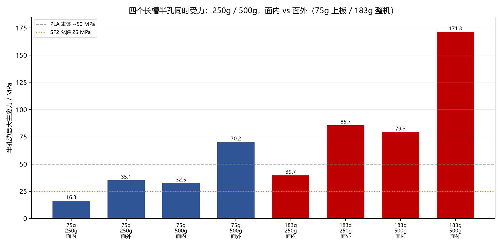
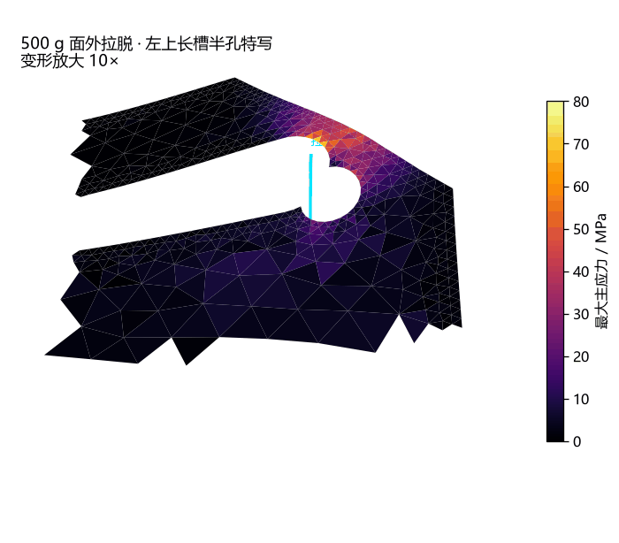
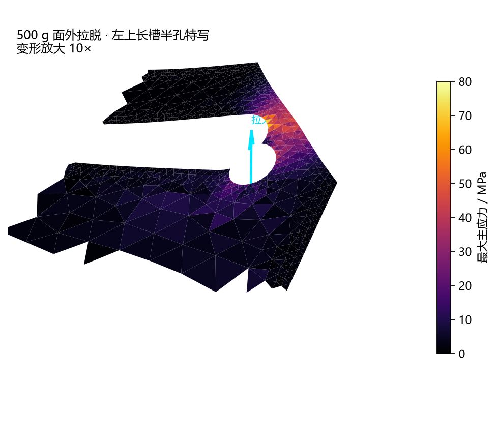

# 09 · 四个长槽半孔的拉脱

> 受力点：上层板 4 个长槽的**外端半孔**（你红圈圈出来的 4 个点），四个一起分担总力。
> 工况：250 g / 500 g；分别按 **75 g 上板质量**（电池 60 g + 上板/电子 15 g）和 **183 g 整机质量**（最坏情况）计算。
> 方向：**面内**（沿槽向外拉）和 **面外**（+Z 向上拉）各算一遍。
> 分析类型：线性静力拉脱筛选，不是瞬态落摔/接触仿真。

> 注：这里的 250 g / 500 g 指**冲击加速度 g 数**，不是 250 g / 500 g 的静重量。若按静重量直接挂，力会小约 75 倍，基本不会坏；真正危险的是冲击放大后的等效载荷。

## 1. 几何

从 STL 中面量出来：

| 项目 | 数值 |
|---|---:|
| 长槽外形 | 约 **4.30 × 12.10 mm** 的跑道形 |
| 半孔半径 | **2.15 mm** |
| 半孔到外缘最小肉厚 | **1.16 mm** |
| 上层板厚度 | 3.0 mm |
| 受力点半孔中心 | 上槽上端 (±18.55, 17.71)；下槽下端 (±18.55, −15.19) mm |

这 4 个半孔离斜边只有 1.16 mm，是整块上层板最薄的承力边。你圈的位置没错，确实是最该算的地方。

## 2. 结果

四个半孔均分总力；单点力 = 总力 / 4。

| 质量 | 冲击 | 方向 | 单点力 | 半孔边最大主应力 | 对 50 MPa 的 SF | 对 25 MPa 的 SF2 | 判断 |
|---:|---:|---|---:|---:|---:|---:|---|
| 75 g | 250 g | 面内 | 46.0 N | **16.3 MPa** | 3.08 | 1.54 | ✅ 安全 |
| 75 g | 250 g | 面外 | 46.0 N | **35.1 MPa** | 1.42 | 0.71 | ⚠️ 边缘 |
| 75 g | 500 g | 面内 | 92.0 N | **32.5 MPa** | 1.54 | 0.77 | ⚠️ 边缘 |
| 75 g | 500 g | 面外 | 92.0 N | **70.2 MPa** | 0.71 | 0.36 | ❌ 超 PLA 本体 |
| 183 g | 250 g | 面内 | 112.2 N | **39.7 MPa** | 1.26 | 0.63 | ⚠️ 边缘 |
| 183 g | 250 g | 面外 | 112.2 N | **85.7 MPa** | 0.58 | 0.29 | ❌ 超 PLA 本体 |
| 183 g | 500 g | 面内 | 224.4 N | **79.3 MPa** | 0.63 | 0.32 | ❌ 超 PLA 本体 |
| 183 g | 500 g | 面外 | 224.4 N | **171.3 MPa** | 0.29 | 0.15 | ❌ 远超 PLA |

### 3D 特写（500 g 面外，最坏工况）

蓝色箭头是 +Z 面外拉力；亮色集中在半孔靠外缘的那一侧，也就是 1.16 mm 肉厚的地方。变形放大 10×。

### 热力图（0 → 500 g）

四个角同时亮起来；500 g 时四个半孔外缘都进入橙色/红色。中间区域基本是黑的，说明载荷路径就是这四个薄边。

## 3. 怎么读

1. **250 g 面内**最安全：75 g 上板时 16.3 MPa，只有本体强度的 1/3。
2. **250 g 面外**已经到 35.1 MPa，超过 SF2 的 25 MPa；如果扎带会把板子往上提，这个工况要当心。
3. **500 g 面内** 32.5 MPa，低于 50 MPa 但安全系数只有 1.5；**500 g 面外 70.2 MPa，直接超过 PLA 本体强度**。
4. 如果整机 183 g 的重量都挂在这 4 个半孔上，**250 g 面外就已经 85.7 MPa**，500 g 更是 171 MPa。也就是说：**这 4 个半孔不能作为电池/整机的唯一承力点。**

这里说的“面外”是扎带/绳子把半孔往上提的方向；“面内”是沿槽方向往外拉。实际扎带通常两者都有，所以真实情况介于两条曲线之间，但**面外分量是最危险的**。

## 4. 加强方案

按“3 mm 厚、应力约按 1/t² 缩放”的粗略估算：

| 局部加厚 | 500 g 面外应力（从 70.2 MPa 起） | 判断 |
|---:|---:|---|
| +1 mm（总 4 mm） | ~39.5 MPa | 仍高于 SF2，低于本体 |
| **+2 mm（总 5 mm）** | **~25.3 MPa** | **刚好到 SF2，推荐** |
| +2.5 mm（总 5.5 mm） | ~20.9 MPa | 更稳 |

具体做法，按优先级：

1. **不要只用这 4 个薄半孔承力**：电池扎带改从底板/独立 strap bar 走，或让扎带绕整块板上方，不要把全部拉力压在半孔上。
2. 半孔外缘加 **2 mm 厚的局部凸台/加强环**；如果不想改 CAD，在扎带和板之间加 **1 mm 铝片/大垫片**，把力摊开。
3. 把长槽往内移，把 1.16 mm 边肉厚做到 **≥2.5 mm**；这是最根本的几何修复。
4. 半孔到斜边的过渡 **R0.8–1 mm 倒圆**，降低应力集中。
5. 如果这四个孔只是用来穿扎带、不承力，塞一个 **TPU/尼龙套管** 保护孔边，别让扎带直接割 PLA。

## 5. 验证

- 挂重：上层板四个半孔同时挂 **10 kg（98 N）**，静置 10 分钟，看孔边白化/裂纹；再挂 15 kg（147 N）看是否屈服。不要直接上 20 kg 以上。
- 落摔：0.5 m 草地 → 1 m 草地 → 0.5 m 硬地，用旧电池/假电池，先拆桨。
- 如果扎带会往上提，做一次“向上提”的挂重测试，不要只做面内拉。

## 6. 局限

- 线性静力，不是瞬态落摔/接触；没有应变率、阻尼、地面反力。
- PLA 各向同性筛选；打印方向、层间强度、缺陷没有实测。
- 扎带与孔壁的接触、摩擦没有建模；载荷是均分到半孔壁节点上的。
- 1.16 mm 肉厚在网格里只有约 2–3 个单元，最终设计建议局部细化或直接挂重验证。
- 半孔到斜边的尖锐过渡是应力集中点，数值会随网格变化；这里用它判断“哪里最危险”，不是当成精确的 171 MPa。

---

### 相关文件

- `outputs/previous-versions/impact/slot_half_hole/slot_pull_summary.csv` — 8 个工况的完整表
- `outputs/previous-versions/impact/slot_half_hole/slot_pull_summary.json` — 结论与假设
- `outputs/previous-versions/impact/slot_half_hole/slot_geometry.png` — 四个半孔位置
- `outputs/previous-versions/impact/slot_half_hole/slot_pull_bars.png` — 柱状图
- `outputs/previous-versions/impact/slot_half_hole/slot_half_hole_3d.gif` — 500 g 面外 3D 特写
- `outputs/previous-versions/impact/slot_half_hole/slot_half_hole_heatmap.gif` — 0→500 g 热力图
- `work/vibration_v2/slot_pull.py` — 半孔拉脱求解
